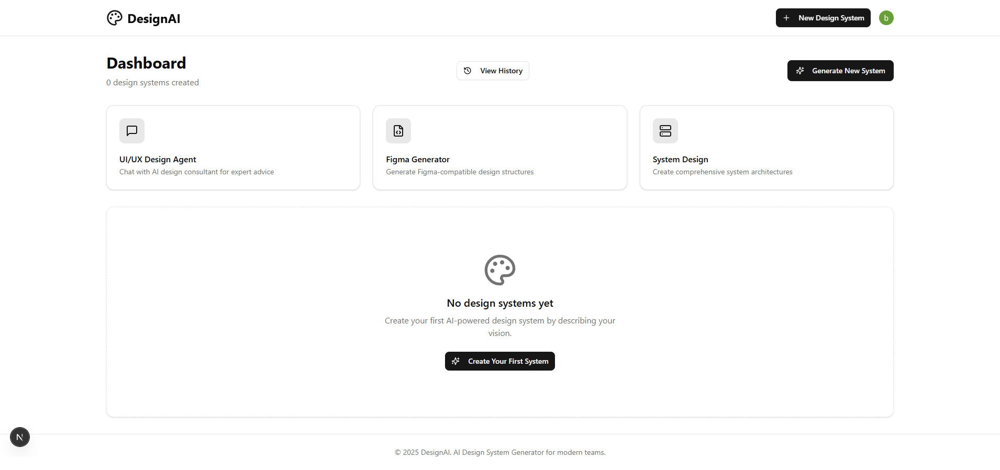
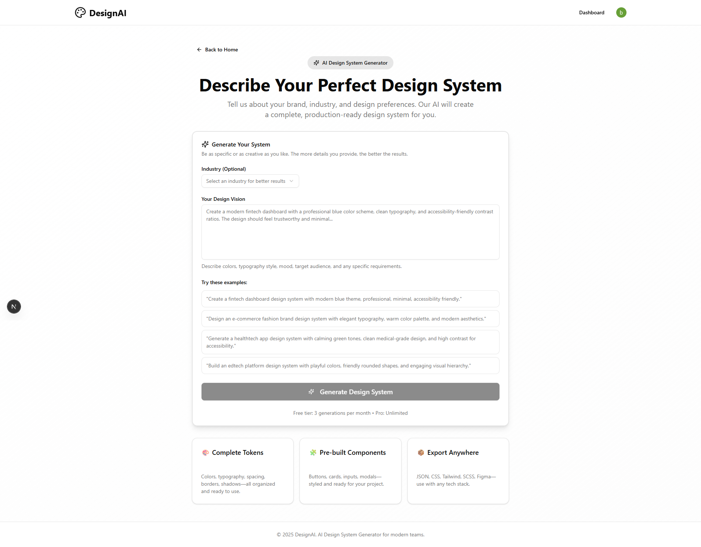

# 🚀 DesignAI - AI-Powered Design System Generator

Transform your design vision into production-ready design systems with AI. Generate colors, typography, spacing, and components in minutes.





## ✨ Features

### 🎨 AI Design System Generator
- **Natural Language Input**: Describe your design vision in plain English
- **Industry-Specific Templates**: Support for Fintech, E-commerce, Healthtech, Edtech, SaaS, Enterprise, and Agency
- **Complete Design Tokens**: Colors, typography, spacing, borders, shadows - all organized and ready to use
- **Pre-built Components**: Buttons, cards, inputs, modals - styled and ready for your project
- **Export Anywhere**: JSON, CSS, Tailwind, SCSS, Figma - use with any tech stack
- **Version History**: Track all changes with comprehensive history

### 🧩 Figma Integration
- **Figma JSON Generator**: Generate Figma-compatible design structures
- **Figma Connect**: Connect and sync with your Figma account
- **Component Extractor**: Extract components from existing Figma files
- **Figma Plugin**: Built-in Figma plugin for seamless workflow

### 🤖 AI Design Agent
- **Chat with AI**: Get expert design advice from AI
- **Context-Aware**: Understands your design system and provides relevant suggestions
- **Self-Correction**: Automatically corrects and improves designs

### 📐 System Design
- **Architecture Planning**: Create comprehensive system architectures
- **Model Routing**: Intelligent routing between different AI models
- **Vision Analysis**: Analyze and improve visual designs

### 🔐 Authentication & User Management
- **Clerk Integration**: Secure authentication with Clerk
- **User Profiles**: Personalized experience with user profiles
- **Sign Out**: Easy logout functionality

### 🗄️ Database & Backend
- **Prisma ORM**: Type-safe database operations
- **SQLite**: Local database for development
- **RESTful APIs**: Complete API for all features

## 🛠️ Technology Stack

### 🎯 Core Framework
- **Next.js 16** - The React framework for production with App Router
- **TypeScript 5** - Type-safe JavaScript for better developer experience
- **Bun** - Fast JavaScript runtime and package manager

### 🎨 UI & Styling
- **Tailwind CSS 4** - Utility-first CSS framework
- **shadcn/ui** - High-quality, accessible components built on Radix UI
- **Lucide React** - Beautiful & consistent icon library
- **Framer Motion** - Production-ready motion library
- **Radix UI** - Unstyled, accessible components

### 🤖 AI & ML
- **Google Gemini** - Advanced AI for design generation
- **Vision Analysis** - Image and design analysis capabilities

### 🔄 State & Data
- **Zustand** - Simple, scalable state management
- **TanStack Query** - Powerful data synchronization

### 🗄️ Database
- **Prisma** - Next-generation TypeScript ORM
- **SQLite** - Lightweight database

### 🔐 Authentication
- **Clerk** - Complete authentication solution

## 📱 Pages

| Page | Route | Description |
|------|-------|-------------|
| Home | `/` | Landing page with features overview |
| Dashboard | `/dashboard` | User dashboard with design systems list |
| Generate | `/generate` | AI design system generator |
| Design System Details | `/design-system/[id]` | View and edit a specific design system |
| History | `/dashboard/history` | View version history |
| Agent | `/agent` | AI design consultant chat |
| Figma | `/figma` | Figma integration tools |
| System Design | `/system-design` | System architecture planning |
| Project | `/project` | Project management |
| Sign In | `/sign-in` | User authentication |
| Sign Up | `/sign-up` | User registration |

## 🔌 API Endpoints

### Design Systems
- `GET /api/design-systems` - List all design systems
- `POST /api/design-systems` - Create a new design system
- `GET /api/design-systems/[id]` - Get a specific design system
- `PUT /api/design-systems/[id]` - Update a design system
- `DELETE /api/design-systems/[id]` - Delete a design system
- `POST /api/design-systems/generate` - Generate a new design system with AI
- `GET /api/design-systems/history` - Get version history
- `GET /api/design-systems/[id]/export` - Export design system
- `GET /api/design-systems/[id]/export-figma` - Export to Figma format

### Figma Integration
- `POST /api/figma/connect` - Connect Figma account
- `POST /api/figma/convert` - Convert design to Figma format
- `POST /api/figma/generate` - Generate Figma designs
- `GET /api/figma/[id]/export` - Export from Figma

### AI Agent
- `POST /api/agent/chat` - Chat with AI agent
- `GET /api/agent/conversations` - List conversations
- `GET /api/agent/conversations/[id]` - Get specific conversation

### System Design
- `POST /api/system-design/generate` - Generate system architecture

## 🚀 Getting Started

```bash
# Install dependencies
bun install

# Start development server
bun run dev

# Build for production
bun run build

# Start production server
bun start
```

Open [http://localhost:3000](http://localhost:3000) to see your application.

## 📁 Project Structure

```
src/
├── app/                    # Next.js App Router pages
│   ├── api/               # API routes
│   ├── dashboard/         # Dashboard pages
│   ├── design-system/     # Design system viewer
│   ├── generate/          # AI generator
│   ├── agent/             # AI agent
│   ├── figma/             # Figma integration
│   └── system-design/     # System design
├── components/
│   ├── ui/               # shadcn/ui components
│   ├── editor/           # Code editor
│   ├── file-tree/        # File tree viewer
│   ├── preview/          # Live preview
│   └── terminal/         # Terminal emulator
├── lib/
│   ├── agent/            # AI agent logic
│   ├── ai/               # AI utilities
│   ├── figma/            # Figma integration
│   ├── github/           # GitHub integration
│   └── webcontainer/     # WebContainer for running code
└── store/                # Zustand stores
```

## 🎨 UI Components

The project includes a comprehensive set of UI components:

- **Layout**: Card, Separator, Aspect Ratio, Resizable Panels
- **Forms**: Input, Textarea, Select, Checkbox, Radio Group, Switch
- **Feedback**: Alert, Toast, Progress, Skeleton
- **Navigation**: Breadcrumb, Menubar, Navigation Menu, Pagination
- **Overlay**: Dialog, Sheet, Popover, Tooltip, Hover Card
- **Data Display**: Badge, Avatar, Calendar, Table
- **Charts**: Line, Bar, Area, Pie charts with Recharts
- **Editor**: Monaco Editor for code editing

## 🤝 Contributing

Contributions are welcome! Please feel free to submit a Pull Request.

## 📄 License

This project is licensed under the MIT License.

---

Built with ❤️ using Next.js, Tailwind CSS, and Google Gemini AI
