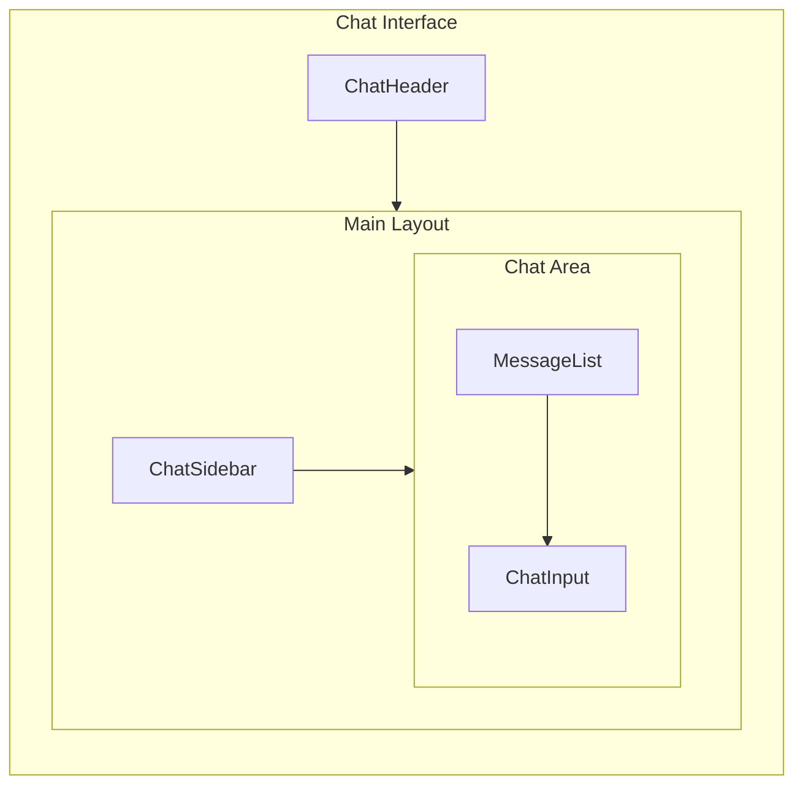
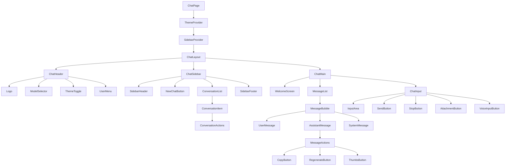
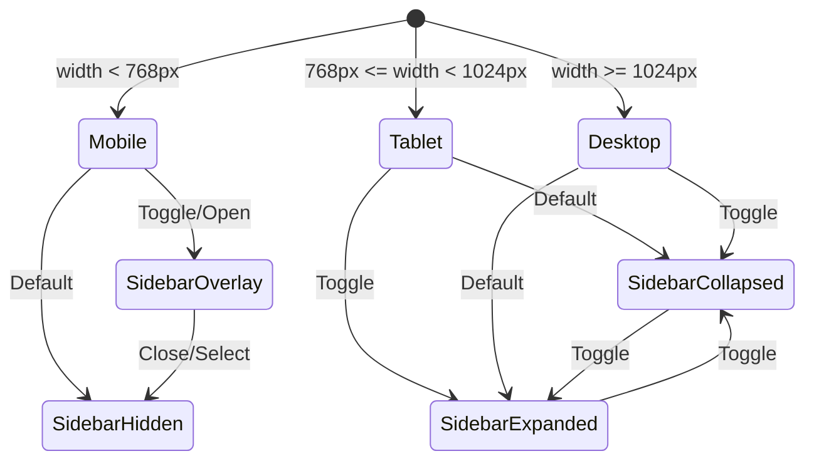
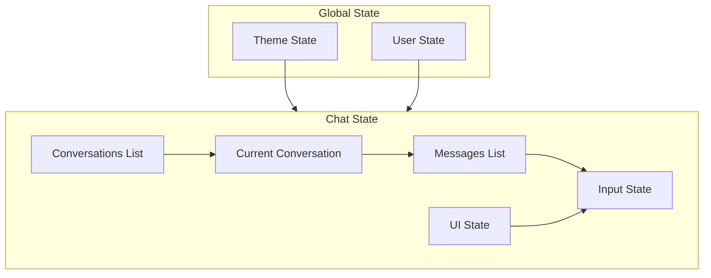

# ChatGPT-like Chat Interface Architecture

## Overview

This document outlines the architecture for a modern ChatGPT-like chat interface with dark/light mode support for the Next.js application. The design builds upon the existing Shadcn/UI component library and Tailwind CSS theming system.

---

## 1. Component Hierarchy

### 1.1 High-Level Architecture



### 1.2 Component Tree



### 1.3 Component Descriptions

| Component | Description | Parent |
|-----------|-------------|--------|
| `ChatPage` | Root page component | - |
| `ThemeProvider` | Manages dark/light theme state | ChatPage |
| `SidebarProvider` | Manages sidebar collapsed state | ThemeProvider |
| `ChatLayout` | Main layout wrapper with responsive grid | SidebarProvider |
| `ChatHeader` | Top navigation bar with actions | ChatLayout |
| `ChatSidebar` | Collapsible conversation history panel | ChatLayout |
| `ChatMain` | Main chat area container | ChatLayout |
| `MessageList` | Scrollable list of messages | ChatMain |
| `MessageBubble` | Individual message container | MessageList |
| `ChatInput` | Message input with actions | ChatMain |

---

## 2. Theme System Specification

### 2.1 CSS Variables Architecture

The theme system uses CSS custom properties with the `oklch` color space for perceptually uniform colors. The system supports both light and dark modes through class-based switching.

```css
/* Theme Variables Structure */
:root {
  /* Base Colors */
  --background: oklch(1 0 0);
  --foreground: oklch(0.145 0 0);
  
  /* Surface Colors */
  --card: oklch(1 0 0);
  --card-foreground: oklch(0.145 0 0);
  --popover: oklch(1 0 0);
  --popover-foreground: oklch(0.145 0 0);
  
  /* Brand Colors */
  --primary: oklch(0.205 0 0);
  --primary-foreground: oklch(0.985 0 0);
  
  /* Secondary Colors */
  --secondary: oklch(0.97 0 0);
  --secondary-foreground: oklch(0.205 0 0);
  
  /* Muted Colors */
  --muted: oklch(0.97 0 0);
  --muted-foreground: oklch(0.556 0 0);
  
  /* Accent Colors */
  --accent: oklch(0.97 0 0);
  --accent-foreground: oklch(0.205 0 0);
  
  /* Semantic Colors */
  --destructive: oklch(0.577 0.245 27.325);
  --success: oklch(0.696 0.17 162.48);
  --warning: oklch(0.769 0.188 70.08);
  --info: oklch(0.646 0.222 41.116);
  
  /* Border & Input */
  --border: oklch(0.922 0 0);
  --input: oklch(0.922 0 0);
  --ring: oklch(0.708 0 0);
  
  /* Chat-specific Colors */
  --chat-background: oklch(0.985 0 0);
  --chat-bubble-user: oklch(0.205 0 0);
  --chat-bubble-assistant: oklch(0.97 0 0);
  --chat-input-bg: oklch(1 0 0);
  --chat-border: oklch(0.922 0 0);
  
  /* Sidebar Colors */
  --sidebar: oklch(0.985 0 0);
  --sidebar-foreground: oklch(0.145 0 0);
  --sidebar-primary: oklch(0.205 0 0);
  --sidebar-primary-foreground: oklch(0.985 0 0);
  --sidebar-accent: oklch(0.97 0 0);
  --sidebar-accent-foreground: oklch(0.205 0 0);
  --sidebar-border: oklch(0.922 0 0);
  --sidebar-ring: oklch(0.708 0 0);
  
  /* Radius */
  --radius: 0.625rem;
  --radius-sm: calc(var(--radius) - 4px);
  --radius-md: calc(var(--radius) - 2px);
  --radius-lg: var(--radius);
  --radius-xl: calc(var(--radius) + 4px);
  --radius-2xl: calc(var(--radius) + 8px);
  
  /* Shadows */
  --shadow-sm: 0 1px 2px 0 rgb(0 0 0 / 0.05);
  --shadow-md: 0 4px 6px -1px rgb(0 0 0 / 0.1);
  --shadow-lg: 0 10px 15px -3px rgb(0 0 0 / 0.1);
  --shadow-xl: 0 20px 25px -5px rgb(0 0 0 / 0.1);
}

.dark {
  --background: oklch(0.145 0 0);
  --foreground: oklch(0.985 0 0);
  
  --card: oklch(0.205 0 0);
  --card-foreground: oklch(0.985 0 0);
  --popover: oklch(0.205 0 0);
  --popover-foreground: oklch(0.985 0 0);
  
  --primary: oklch(0.922 0 0);
  --primary-foreground: oklch(0.205 0 0);
  
  --secondary: oklch(0.269 0 0);
  --secondary-foreground: oklch(0.985 0 0);
  
  --muted: oklch(0.269 0 0);
  --muted-foreground: oklch(0.708 0 0);
  
  --accent: oklch(0.269 0 0);
  --accent-foreground: oklch(0.985 0 0);
  
  --destructive: oklch(0.704 0.191 22.216);
  --success: oklch(0.696 0.17 162.48);
  --warning: oklch(0.769 0.188 70.08);
  --info: oklch(0.488 0.243 264.376);
  
  --border: oklch(1 0 0 / 10%);
  --input: oklch(1 0 0 / 15%);
  --ring: oklch(0.556 0 0);
  
  /* Chat-specific Dark Colors */
  --chat-background: oklch(0.145 0 0);
  --chat-bubble-user: oklch(0.205 0 0);
  --chat-bubble-assistant: oklch(0.269 0 0);
  --chat-input-bg: oklch(0.205 0 0);
  --chat-border: oklch(1 0 0 / 10%);
  
  --sidebar: oklch(0.12 0 0);
  --sidebar-foreground: oklch(0.985 0 0);
  --sidebar-primary: oklch(0.488 0.243 264.376);
  --sidebar-primary-foreground: oklch(0.985 0 0);
  --sidebar-accent: oklch(0.269 0 0);
  --sidebar-accent-foreground: oklch(0.985 0 0);
  --sidebar-border: oklch(1 0 0 / 10%);
  --sidebar-ring: oklch(0.556 0 0);
  
  /* Dark Shadows */
  --shadow-sm: 0 1px 2px 0 rgb(0 0 0 / 0.2);
  --shadow-md: 0 4px 6px -1px rgb(0 0 0 / 0.3);
  --shadow-lg: 0 10px 15px -3px rgb(0 0 0 / 0.3);
  --shadow-xl: 0 20px 25px -5px rgb(0 0 0 / 0.3);
}
```

### 2.2 Theme Toggle Implementation

```typescript
// Theme state management
interface ThemeContextValue {
  theme: 'light' | 'dark' | 'system';
  setTheme: (theme: 'light' | 'dark' | 'system') => void;
  resolvedTheme: 'light' | 'dark';
  toggleTheme: () => void;
}

// Theme persistence
// - Store preference in localStorage
// - Sync with system preference via matchMedia
// - Apply class to document.documentElement
```

### 2.3 Smooth Theme Transitions

```css
/* Global transition for theme changes */
* {
  transition: background-color 0.2s ease, 
              border-color 0.2s ease, 
              color 0.2s ease;
}

/* Disable transitions during initial load */
.no-transitions * {
  transition: none !important;
}
```

---

## 3. Component Specifications

### 3.1 ChatLayout

```typescript
interface ChatLayoutProps {
  children: React.ReactNode;
  defaultSidebarOpen?: boolean;
  onSidebarChange?: (open: boolean) => void;
}
```

**Responsibilities:**
- Manages responsive grid layout
- Handles sidebar collapse/expand state
- Provides context for child components

### 3.2 ChatHeader

```typescript
interface ChatHeaderProps {
  title?: string;
  showModelSelector?: boolean;
  actions?: React.ReactNode;
  onNewChat?: () => void;
  onExport?: () => void;
}
```

**Features:**
- Sticky positioning with backdrop blur
- Model selector dropdown
- Theme toggle button
- User menu with sign out option
- New chat button

### 3.3 ChatSidebar

```typescript
interface ChatSidebarProps {
  conversations: Conversation[];
  activeId?: string;
  onSelect: (id: string) => void;
  onNewChat: () => void;
  onDelete: (id: string) => void;
  onRename: (id: string, title: string) => void;
  searchQuery?: string;
  onSearchChange?: (query: string) => void;
  isLoading?: boolean;
}

interface Conversation {
  id: string;
  title: string;
  createdAt: string;
  updatedAt: string;
  messageCount: number;
  type?: string;
}
```

**Features:**
- Collapsible with smooth animation
- Search functionality
- Conversation grouping by date
- Context menu for actions
- Mobile sheet overlay

### 3.4 ConversationItem

```typescript
interface ConversationItemProps {
  conversation: Conversation;
  isActive: boolean;
  onSelect: () => void;
  onRename: () => void;
  onDelete: () => void;
  onShare?: () => void;
}
```

### 3.5 MessageList

```typescript
interface MessageListProps {
  messages: Message[];
  isLoading?: boolean;
  onRegenerate?: (messageId: string) => void;
  onEdit?: (messageId: string, content: string) => void;
  onReaction?: (messageId: string, reaction: 'up' | 'down' | null) => void;
}

interface Message {
  id: string;
  role: 'user' | 'assistant' | 'system';
  content: string;
  timestamp: string;
  isStreaming?: boolean;
  isEditing?: boolean;
  reaction?: 'up' | 'down' | null;
  metadata?: {
    model?: string;
    tokens?: number;
    finishReason?: string;
  };
}
```

**Features:**
- Auto-scroll to bottom on new messages
- Virtual scrolling for large message lists
- Welcome screen when empty
- Suggested prompts display

### 3.6 MessageBubble

```typescript
interface MessageBubbleProps {
  message: Message;
  isLast?: boolean;
  onCopy?: () => void;
  onRegenerate?: () => void;
  onEdit?: (content: string) => void;
  onReaction?: (reaction: 'up' | 'down' | null) => void;
}
```

**Variants:**
- `UserMessage`: Right-aligned, primary color background
- `AssistantMessage`: Left-aligned, muted background with avatar
- `SystemMessage`: Centered, subtle styling

### 3.7 AssistantMessage

```typescript
interface AssistantMessageProps extends MessageBubbleProps {
  avatar?: {
    src?: string;
    fallback: string;
  };
  showActions?: boolean;
}
```

**Features:**
- Markdown rendering with syntax highlighting
- Code block copy functionality
- Typing indicator during streaming
- Feedback buttons (thumbs up/down)
- Copy full message action
- Regenerate response action

### 3.8 ChatInput

```typescript
interface ChatInputProps {
  value: string;
  onChange: (value: string) => void;
  onSubmit: (message: string) => void;
  onStop?: () => void;
  isGenerating?: boolean;
  isDisabled?: boolean;
  placeholder?: string;
  maxLength?: number;
  showVoiceInput?: boolean;
  showAttachments?: boolean;
}
```

**Features:**
- Auto-resize textarea
- Keyboard shortcuts (Enter to send, Shift+Enter for newline)
- Voice input support
- File attachment support
- Stop generation button
- Character/token counter
- Focus management

### 3.9 TypingIndicator

```typescript
interface TypingIndicatorProps {
  className?: string;
}
```

**Animation:**
- Three dots with staggered bounce animation
- Configurable animation timing

### 3.10 WelcomeScreen

```typescript
interface WelcomeScreenProps {
  suggestedPrompts?: string[];
  onPromptSelect: (prompt: string) => void;
  title?: string;
  description?: string;
}
```

**Features:**
- Centered layout with logo
- Suggested prompts grid
- Quick action buttons

### 3.11 MessageActions

```typescript
interface MessageActionsProps {
  messageId: string;
  onCopy?: () => void;
  onRegenerate?: () => void;
  onEdit?: () => void;
  onReaction?: (type: 'up' | 'down') => void;
  currentReaction?: 'up' | 'down' | null;
  isCopied?: boolean;
  showEdit?: boolean;
  showRegenerate?: boolean;
}
```

---

## 4. Responsive Breakpoints and Behavior

### 4.1 Breakpoint Definitions

| Breakpoint | Width | Description |
|------------|-------|-------------|
| `xs` | < 640px | Mobile phones |
| `sm` | ≥ 640px | Large phones |
| `md` | ≥ 768px | Tablets |
| `lg` | ≥ 1024px | Laptops |
| `xl` | ≥ 1280px | Desktops |
| `2xl` | ≥ 1536px | Large screens |

### 4.2 Layout Behavior



### 4.3 Responsive Component Behavior

| Component | Mobile (<768px) | Tablet (768-1024px) | Desktop (>1024px) |
|-----------|-----------------|---------------------|-------------------|
| **Sidebar** | Hidden, sheet overlay | Collapsed to icons | Expanded, collapsible |
| **Header** | Compact, hamburger menu | Full with collapse toggle | Full with all actions |
| **MessageList** | Full width, 16px padding | Max-width 768px, centered | Max-width 896px, centered |
| **ChatInput** | Full width, minimal actions | Max-width 768px, centered | Max-width 896px, centered |
| **MessageBubble** | Full width within container | 85% max width | 80% max width |

### 4.4 Grid Layout

```css
/* Desktop Layout */
.chat-layout {
  display: grid;
  grid-template-columns: 260px 1fr;
  grid-template-rows: auto 1fr;
  height: 100vh;
}

/* Sidebar Collapsed */
.chat-layout[data-sidebar="collapsed"] {
  grid-template-columns: 64px 1fr;
}

/* Tablet Layout */
@media (max-width: 1024px) {
  .chat-layout {
    grid-template-columns: 1fr;
  }
  
  .chat-sidebar {
    position: fixed;
    left: 0;
    top: 0;
    bottom: 0;
    z-index: 50;
    transform: translateX(-100%);
    transition: transform 0.3s ease;
  }
  
  .chat-sidebar[data-open="true"] {
    transform: translateX(0);
  }
}

/* Mobile Layout */
@media (max-width: 768px) {
  .chat-header {
    padding: 0.75rem 1rem;
  }
  
  .message-list {
    padding: 1rem;
  }
  
  .chat-input-container {
    padding: 0.75rem;
  }
}
```

---

## 5. Color Palette

### 5.1 Light Mode Palette

| Token | Value | Usage |
|-------|-------|-------|
| `--background` | `oklch(1 0 0)` | Page background |
| `--foreground` | `oklch(0.145 0 0)` | Primary text |
| `--card` | `oklch(1 0 0)` | Card backgrounds |
| `--primary` | `oklch(0.205 0 0)` | Primary actions, user bubbles |
| `--secondary` | `oklch(0.97 0 0)` | Secondary surfaces |
| `--muted` | `oklch(0.97 0 0)` | Assistant bubbles, disabled |
| `--muted-foreground` | `oklch(0.556 0 0)` | Secondary text |
| `--accent` | `oklch(0.97 0 0)` | Hover states |
| `--border` | `oklch(0.922 0 0)` | Borders, dividers |
| `--ring` | `oklch(0.708 0 0)` | Focus rings |

### 5.2 Dark Mode Palette

| Token | Value | Usage |
|-------|-------|-------|
| `--background` | `oklch(0.145 0 0)` | Page background |
| `--foreground` | `oklch(0.985 0 0)` | Primary text |
| `--card` | `oklch(0.205 0 0)` | Card backgrounds |
| `--primary` | `oklch(0.922 0 0)` | Primary actions, user bubbles |
| `--secondary` | `oklch(0.269 0 0)` | Secondary surfaces |
| `--muted` | `oklch(0.269 0 0)` | Assistant bubbles, disabled |
| `--muted-foreground` | `oklch(0.708 0 0)` | Secondary text |
| `--accent` | `oklch(0.269 0 0)` | Hover states |
| `--border` | `oklch(1 0 0 / 10%)` | Borders, dividers |
| `--ring` | `oklch(0.556 0 0)` | Focus rings |

### 5.3 Semantic Colors

| Token | Light Mode | Dark Mode | Usage |
|-------|------------|-----------|-------|
| `--destructive` | `oklch(0.577 0.245 27.325)` | `oklch(0.704 0.191 22.216)` | Errors, delete actions |
| `--success` | `oklch(0.696 0.17 162.48)` | `oklch(0.696 0.17 162.48)` | Success states |
| `--warning` | `oklch(0.769 0.188 70.08)` | `oklch(0.769 0.188 70.08)` | Warning states |
| `--info` | `oklch(0.646 0.222 41.116)` | `oklch(0.488 0.243 264.376)` | Information states |

### 5.4 Chat-Specific Colors

| Token | Light Mode | Dark Mode | Usage |
|-------|------------|-----------|-------|
| `--chat-bubble-user` | `oklch(0.205 0 0)` | `oklch(0.205 0 0)` | User message background |
| `--chat-bubble-assistant` | `oklch(0.97 0 0)` | `oklch(0.269 0 0)` | Assistant message background |
| `--chat-input-bg` | `oklch(1 0 0)` | `oklch(0.205 0 0)` | Input field background |
| `--chat-border` | `oklch(0.922 0 0)` | `oklch(1 0 0 / 10%)` | Chat borders |

---

## 6. Typography Scale

### 6.1 Font Families

```css
:root {
  --font-sans: 'Inter', system-ui, -apple-system, sans-serif;
  --font-mono: 'JetBrains Mono', 'Fira Code', monospace;
}
```

### 6.2 Type Scale

| Name | Size | Line Height | Weight | Usage |
|------|------|-------------|--------|-------|
| `text-xs` | 0.75rem (12px) | 1rem | 400 | Timestamps, labels |
| `text-sm` | 0.875rem (14px) | 1.25rem | 400 | Body text, messages |
| `text-base` | 1rem (16px) | 1.5rem | 400 | Primary body text |
| `text-lg` | 1.125rem (18px) | 1.75rem | 400 | Large body text |
| `text-xl` | 1.25rem (20px) | 1.75rem | 600 | Card titles |
| `text-2xl` | 1.5rem (24px) | 2rem | 700 | Section headers |
| `text-3xl` | 1.875rem (30px) | 2.25rem | 700 | Page titles |

### 6.3 Code Typography

```css
code, pre {
  font-family: var(--font-mono);
  font-size: 0.875em;
}

pre {
  padding: 1rem;
  border-radius: var(--radius-lg);
  overflow-x: auto;
}

code {
  padding: 0.125rem 0.25rem;
  border-radius: var(--radius-sm);
  background-color: var(--muted);
}
```

---

## 7. Spacing System

### 7.1 Spacing Scale

| Token | Value | Usage |
|-------|-------|-------|
| `space-0` | 0 | No spacing |
| `space-1` | 0.25rem (4px) | Tight spacing |
| `space-2` | 0.5rem (8px) | Compact spacing |
| `space-3` | 0.75rem (12px) | Default small |
| `space-4` | 1rem (16px) | Default medium |
| `space-5` | 1.25rem (20px) | Comfortable |
| `space-6` | 1.5rem (24px) | Section spacing |
| `space-8` | 2rem (32px) | Large spacing |
| `space-10` | 2.5rem (40px) | Extra large |
| `space-12` | 3rem (48px) | Section margins |

### 7.2 Component Spacing

| Component | Padding | Gap |
|-----------|---------|-----|
| `ChatHeader` | `0.75rem 1rem` | `0.5rem` |
| `ChatSidebar` | `0.5rem` | `0.25rem` |
| `MessageBubble` | `1rem` | - |
| `MessageList` | `1rem` | `1rem` |
| `ChatInput` | `0.75rem 1rem` | `0.5rem` |
| `ConversationItem` | `0.75rem` | `0.5rem` |

---

## 8. Border Radius Values

| Token | Value | Usage |
|-------|-------|-------|
| `radius-sm` | 4px | Badges, small elements |
| `radius-md` | 6px | Buttons, inputs |
| `radius-lg` | 10px | Cards, dropdowns |
| `radius-xl` | 14px | Modals, large cards |
| `radius-2xl` | 18px | Message bubbles |
| `radius-full` | 9999px | Avatars, pills |

---

## 9. Shadow Definitions

### 9.1 Light Mode Shadows

```css
:root {
  --shadow-sm: 0 1px 2px 0 rgb(0 0 0 / 0.05);
  --shadow-md: 0 4px 6px -1px rgb(0 0 0 / 0.1), 
               0 2px 4px -2px rgb(0 0 0 / 0.1);
  --shadow-lg: 0 10px 15px -3px rgb(0 0 0 / 0.1), 
               0 4px 6px -4px rgb(0 0 0 / 0.1);
  --shadow-xl: 0 20px 25px -5px rgb(0 0 0 / 0.1), 
               0 8px 10px -6px rgb(0 0 0 / 0.1);
}
```

### 9.2 Dark Mode Shadows

```css
.dark {
  --shadow-sm: 0 1px 2px 0 rgb(0 0 0 / 0.2);
  --shadow-md: 0 4px 6px -1px rgb(0 0 0 / 0.3), 
               0 2px 4px -2px rgb(0 0 0 / 0.2);
  --shadow-lg: 0 10px 15px -3px rgb(0 0 0 / 0.3), 
               0 4px 6px -4px rgb(0 0 0 / 0.2);
  --shadow-xl: 0 20px 25px -5px rgb(0 0 0 / 0.3), 
               0 8px 10px -6px rgb(0 0 0 / 0.2);
}
```

---

## 10. File Structure Recommendation

```
src/
├── app/
│   ├── chat/
│   │   ├── page.tsx                    # Chat page entry
│   │   ├── layout.tsx                  # Chat layout with providers
│   │   └── [conversationId]/
│   │       └── page.tsx                # Specific conversation view
│   ├── api/
│   │   └── chat/
│   │       ├── route.ts                # Chat API endpoint
│   │       └── [conversationId]/
│   │           └── route.ts            # Conversation CRUD
│   └── globals.css                     # Global styles & CSS variables
│
├── components/
│   ├── chat/
│   │   ├── ChatLayout.tsx              # Main layout wrapper
│   │   ├── ChatHeader.tsx              # Top navigation
│   │   ├── ChatSidebar.tsx             # Sidebar container
│   │   ├── ChatMain.tsx                # Main chat area
│   │   ├── ChatInput.tsx               # Message input component
│   │   ├── index.ts                    # Barrel export
│   │   │
│   │   ├── messages/
│   │   │   ├── MessageList.tsx         # Messages container
│   │   │   ├── MessageBubble.tsx       # Message wrapper
│   │   │   ├── UserMessage.tsx         # User message variant
│   │   │   ├── AssistantMessage.tsx    # Assistant message variant
│   │   │   ├── SystemMessage.tsx       # System message variant
│   │   │   ├── MessageActions.tsx      # Message action buttons
│   │   │   ├── TypingIndicator.tsx     # Typing animation
│   │   │   └── index.ts
│   │   │
│   │   ├── sidebar/
│   │   │   ├── ConversationList.tsx    # Conversation list
│   │   │   ├── ConversationItem.tsx    # Single conversation
│   │   │   ├── ConversationActions.tsx # Context menu actions
│   │   │   ├── NewChatButton.tsx       # New chat CTA
│   │   │   ├── SidebarSearch.tsx       # Search input
│   │   │   └── index.ts
│   │   │
│   │   └── welcome/
│   │       ├── WelcomeScreen.tsx       # Empty state
│   │       ├── SuggestedPrompts.tsx    # Prompt suggestions
│   │       └── index.ts
│   │
│   ├── theme/
│   │   ├── ThemeProvider.tsx           # Theme context provider
│   │   ├── ThemeToggle.tsx             # Theme toggle button
│   │   └── index.ts
│   │
│   └── ui/                             # Shadcn/UI components
│       ├── button.tsx
│       ├── input.tsx
│       ├── textarea.tsx
│       ├── scroll-area.tsx
│       ├── avatar.tsx
│       ├── dropdown-menu.tsx
│       ├── dialog.tsx
│       ├── tooltip.tsx
│       └── ...
│
├── hooks/
│   ├── useChat.ts                      # Chat logic hook
│   ├── useConversations.ts             # Conversation management
│   ├── useTheme.ts                     # Theme hook
│   ├── useLocalStorage.ts              # Local storage hook
│   └── useMediaQuery.ts                # Media query hook
│
├── lib/
│   ├── utils.ts                        # Utility functions
│   ├── cn.ts                           # Class name utility
│   └── constants.ts                    # App constants
│
├── types/
│   ├── chat.ts                         # Chat types
│   ├── conversation.ts                 # Conversation types
│   └── theme.ts                        # Theme types
│
└── styles/
    ├── chat.css                        # Chat-specific styles
    ├── animations.css                  # Animation keyframes
    └── markdown.css                    # Markdown styling
```

---

## 11. State Management

### 11.1 State Architecture



### 11.2 State Structure

```typescript
// Chat State
interface ChatState {
  // Conversations
  conversations: Conversation[];
  activeConversationId: string | null;
  isLoadingConversations: boolean;
  
  // Messages
  messages: Message[];
  isGenerating: boolean;
  streamingMessageId: string | null;
  
  // Input
  inputValue: string;
  isEditing: boolean;
  editingMessageId: string | null;
  
  // UI
  sidebarOpen: boolean;
  searchQuery: string;
  showWelcome: boolean;
}

// Theme State
interface ThemeState {
  theme: 'light' | 'dark' | 'system';
  resolvedTheme: 'light' | 'dark';
}
```

---

## 12. Animation Specifications

### 12.1 Transition Timings

| Animation | Duration | Easing | Usage |
|-----------|----------|--------|-------|
| `fast` | 150ms | ease-out | Hover states, toggles |
| `normal` | 200ms | ease-in-out | Theme transitions |
| `slow` | 300ms | ease-in-out | Sidebar collapse |
| `message` | 200ms | ease-out | Message appear |

### 12.2 Keyframe Animations

```css
/* Typing indicator bounce */
@keyframes bounce {
  0%, 80%, 100% {
    transform: translateY(0);
  }
  40% {
    transform: translateY(-6px);
  }
}

/* Message fade in */
@keyframes fadeIn {
  from {
    opacity: 0;
    transform: translateY(10px);
  }
  to {
    opacity: 1;
    transform: translateY(0);
  }
}

/* Sidebar slide */
@keyframes slideIn {
  from {
    transform: translateX(-100%);
  }
  to {
    transform: translateX(0);
  }
}
```

---

## 13. Accessibility Considerations

### 13.1 ARIA Labels

- All interactive elements must have accessible names
- Use `aria-label` for icon-only buttons
- Implement `aria-live` regions for dynamic content
- Use `aria-expanded` for collapsible sections

### 13.2 Keyboard Navigation

| Key | Action |
|-----|--------|
| `Enter` | Send message (when input focused) |
| `Shift + Enter` | New line in input |
| `Escape` | Close modals/dropdowns |
| `Ctrl/Cmd + B` | Toggle sidebar |
| `Ctrl/Cmd + N` | New conversation |
| `Ctrl/Cmd + /` | Focus input |
| `Arrow Up/Down` | Navigate messages (when focused) |

### 13.3 Focus Management

- Auto-focus input on page load
- Return focus to input after sending message
- Trap focus in modals
- Visible focus indicators on all interactive elements

---

## 14. Performance Considerations

### 14.1 Optimization Strategies

1. **Virtual Scrolling**: For conversations with 100+ messages
2. **Message Pagination**: Load messages in chunks
3. **Debounced Search**: 300ms delay on conversation search
4. **Memoization**: Memoize message components
5. **Code Splitting**: Lazy load markdown renderer

### 14.2 Bundle Size

- Use tree-shaking for icons (Lucide React)
- Dynamic imports for syntax highlighter
- Consider lighter markdown parser alternatives

---

## 15. Implementation Phases

### Phase 1: Foundation
- [ ] Set up theme provider and CSS variables
- [ ] Create base layout components
- [ ] Implement responsive grid

### Phase 2: Core Components
- [ ] Build ChatInput with auto-resize
- [ ] Create MessageList with scroll management
- [ ] Implement message bubble variants

### Phase 3: Sidebar
- [ ] Build collapsible sidebar
- [ ] Implement conversation list
- [ ] Add search functionality

### Phase 4: Interactions
- [ ] Add message actions (copy, regenerate)
- [ ] Implement feedback system
- [ ] Add typing indicator

### Phase 5: Polish
- [ ] Add animations and transitions
- [ ] Implement keyboard shortcuts
- [ ] Accessibility audit

---

## 16. Dependencies

### Existing Dependencies (Already Installed)
- `tailwindcss` - Styling
- `@radix-ui/*` - UI primitives (via Shadcn/UI)
- `lucide-react` - Icons
- `react-markdown` - Markdown rendering
- `remark-gfm` - GitHub Flavored Markdown
- `react-syntax-highlighter` - Code highlighting

### Recommended Additional Dependencies
- `next-themes` - Theme management
- `@tanstack/react-virtual` - Virtual scrolling (optional)
- `zustand` or `jotai` - State management (optional)

---

## Summary

This architecture provides a comprehensive foundation for building a ChatGPT-like interface with:

1. **Modular Component Structure**: Clear separation of concerns with reusable components
2. **Robust Theme System**: CSS variables-based theming with smooth transitions
3. **Responsive Design**: Mobile-first approach with adaptive layouts
4. **Accessibility**: WCAG-compliant interactions and keyboard navigation
5. **Performance**: Optimized rendering and lazy loading strategies
6. **Scalability**: File structure that supports feature growth

The design leverages the existing Shadcn/UI component library and Tailwind CSS infrastructure, ensuring consistency with the rest of the application while providing a modern, polished chat experience.