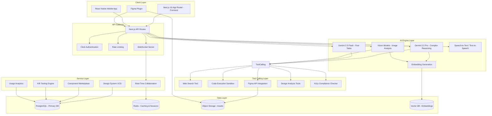
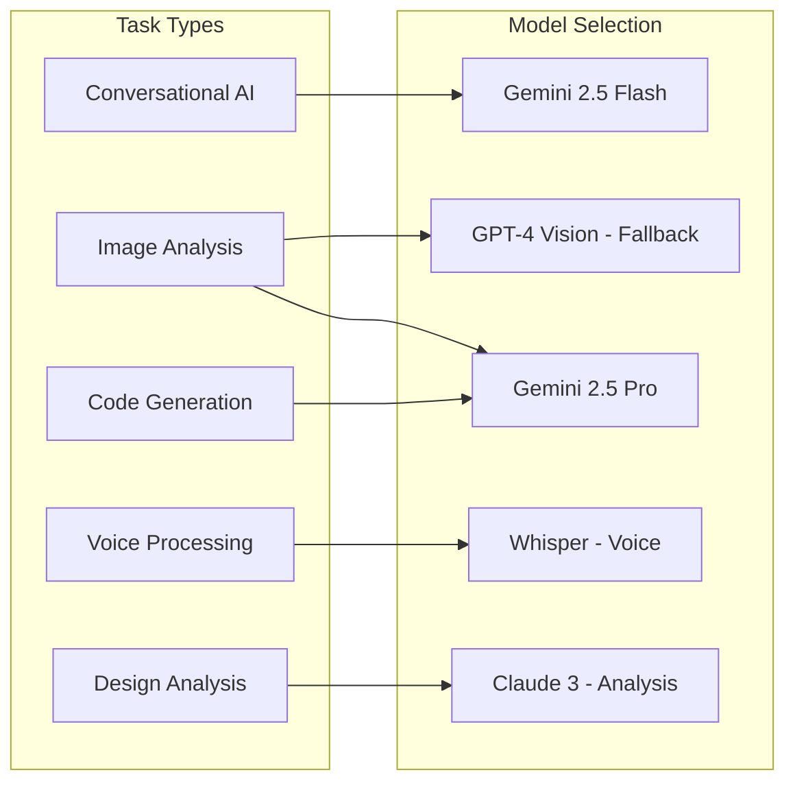
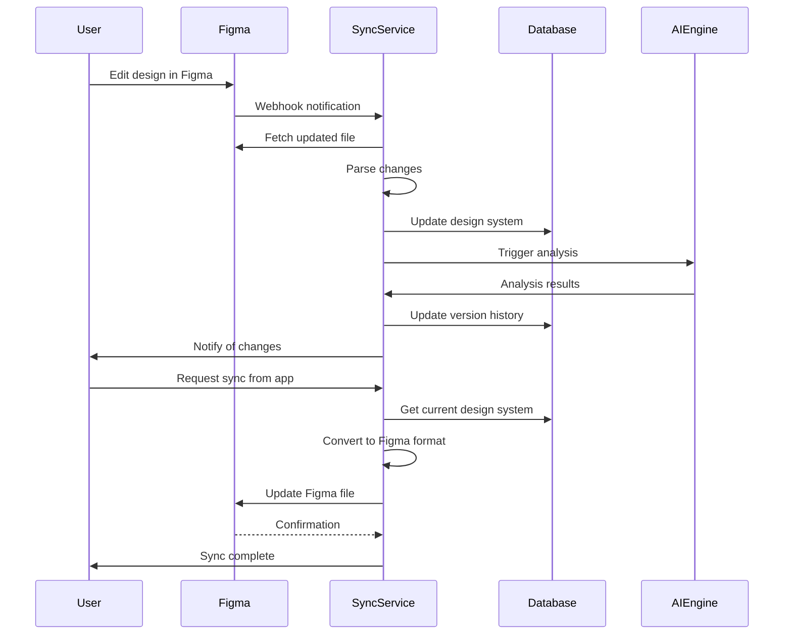
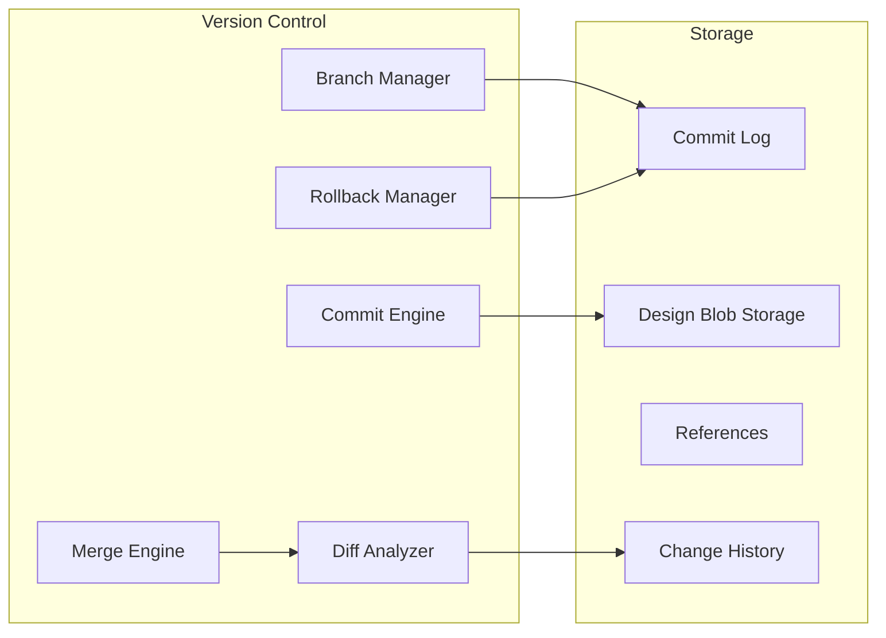
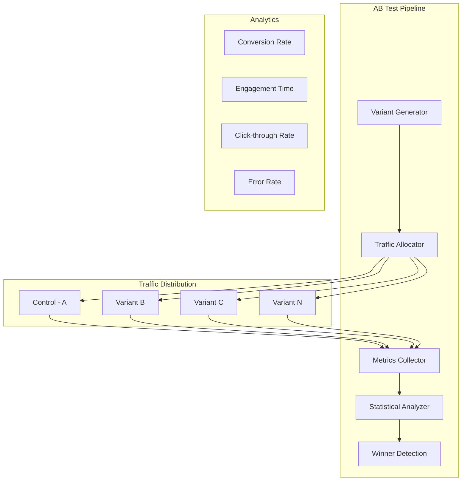

# Advanced AI Agent Architecture for UX/UI and Figma

**Version:** 1.0  
**Date:** February 12, 2026  
**Status:** Draft - For Review

---

## Executive Summary

This document outlines a comprehensive architecture plan for evolving the current nikhil-ui-ux platform into an advanced AI-powered design system and collaboration platform. The architecture extends the existing Next.js 16 + Gemini AI foundation to support multi-modal AI capabilities, real-time collaboration, Figma integration, design system version control, and enterprise-grade features.

---

## 1. System Architecture Overview

### 1.1 High-Level Architecture Diagram



### 1.2 Current Architecture Analysis

**Strengths to Preserve:**
- Next.js 16 App Router with standalone deployment
- Prisma ORM with type-safe database access
- Clerk authentication integration
- Radix UI component library
- Gemini AI integration with JSON capabilities

**Areas for Enhancement:**
- Single-model AI approach → Multi-model architecture
- SQLite → PostgreSQL for scalability
- REST-only → WebSocket + REST
- No version control → Git-like design system versioning
- No real-time collaboration → WebSocket-based collaboration
- Basic Figma export → Bidirectional Figma sync

---

## 2. Multi-Modal AI Architecture

### 2.1 AI Model Selection Strategy



### 2.2 Multi-Modal Capabilities

#### 2.2.1 Image Analysis Pipeline

```typescript
// src/lib/ai/vision-analyzer.ts
interface ImageAnalysisRequest {
  image: Buffer | URL;
  analysisType: 'design-review' | 'screenshot-to-code' | 'token-extraction' | 'accessibility';
  context?: DesignSystem;
}

class VisionAnalyzer {
  async analyze(request: ImageAnalysisRequest): Promise<AnalysisResult> {
    // Pre-processing
    const optimizedImage = await this.optimizeImage(request.image);
    
    // Multi-pass analysis
    const [colors, typography, layout, accessibility] = await Promise.all([
      this.extractColors(optimizedImage),
      this.extractTypography(optimizedImage),
      this.analyzeLayout(optimizedImage),
      this.checkAccessibility(optimizedImage)
    ]);
    
    return this.synthesizeResults({ colors, typography, layout, accessibility });
  }
}
```

#### 2.2.2 Screenshot-to-Code Converter

```typescript
// src/lib/ai/screenshot-converter.ts
interface ConversionRequest {
  screenshot: Buffer;
  targetFramework: 'react' | 'vue' | 'svelte' | 'html';
  designTokens?: DesignTokens;
  componentLibrary?: string;
}

class ScreenshotConverter {
  async convert(request: ConversionRequest): Promise<ConversionResult> {
    // 1. Detect UI elements using vision model
    const elements = await this.detectElements(request.screenshot);
    
    // 2. Generate component hierarchy
    const hierarchy = this.buildHierarchy(elements);
    
    // 3. Extract styles for each element
    const styles = await this.extractStyles(elements, request.designTokens);
    
    // 4. Generate code in target framework
    const code = await this.generateCode(hierarchy, styles, request.targetFramework);
    
    // 5. Validate generated code
    const validation = await this.validateCode(code);
    
    return { code, hierarchy, validation };
  }
}
```

### 2.3 Design Token Extraction

```typescript
// src/lib/ai/token-extractor.ts
interface ExtractedTokens {
  colors: ColorToken[];
  typography: TypographyToken[];
  spacing: SpacingToken[];
  shadows: ShadowToken[];
  borderRadius: BorderRadiusToken[];
}

class TokenExtractor {
  async extract(image: Buffer): Promise<ExtractedTokens> {
    const visionResult = await this.analyzeWithVision(image);
    
    return {
      colors: this.parseColors(visionResult),
      typography: this.parseTypography(visionResult),
      spacing: this.parseSpacing(visionResult),
      shadows: this.parseShadows(visionResult),
      borderRadius: this.parseBorderRadius(visionResult)
    };
  }
}
```

---

## 3. Tool-Calling Architecture

### 3.1 Tool Registry System

```typescript
// src/lib/tools/tool-registry.ts

interface ToolDefinition {
  name: string;
  description: string;
  parameters: z.ZodSchema;
  handler: ToolHandler;
  category: 'search' | 'execution' | 'figma' | 'analysis' | 'a11y';
}

class ToolRegistry {
  private tools: Map<string, ToolDefinition> = new Map();
  
  register(tool: ToolDefinition): void {
    this.tools.set(tool.name, tool);
  }
  
  getTool(name: string): ToolDefinition | undefined {
    return this.tools.get(name);
  }
  
  getToolsByCategory(category: string): ToolDefinition[] {
    return Array.from(this.tools.values()).filter(t => t.category === category);
  }
  
  async execute(name: string, params: any): Promise<ToolResult> {
    const tool = this.getTool(name);
    if (!tool) throw new Error(`Tool not found: ${name}`);
    
    // Validate parameters
    const validatedParams = tool.parameters.parse(params);
    
    // Execute with timeout
    return withTimeout(tool.handler(validatedParams), 30000);
  }
}
```

### 3.2 Web Search Tool

```typescript
// src/lib/tools/web-search.ts

class WebSearchTool {
  async search(query: string, options?: SearchOptions): Promise<SearchResult[]> {
    // Integrate with search API (Google, Bing, or specialized design search)
    const results = await searchAPI.search({
      query,
      numResults: options?.maxResults || 10,
      filters: {
        dateRange: options?.dateRange,
        site: options?.sites,
        type: 'article' | 'blog' | 'documentation'
      }
    });
    
    // Filter and rank results
    return this.rankResults(results, query);
  }
  
  async searchDesignTrends(framework?: string): Promise<DesignTrend[]> {
    // Specialized search for design trends
    const query = framework 
      ? `${framework} UI design trends 2024 2025`
      : 'UI/UX design trends 2024 2025';
    
    return this.search(query, { maxResults: 20 });
  }
}
```

### 3.3 Code Execution Sandbox

```typescript
// src/lib/tools/code-executor.ts

interface ExecutionRequest {
  code: string;
  language: 'typescript' | 'javascript' | 'css' | 'html';
  timeout?: number;
  sandbox?: boolean;
}

class CodeExecutor {
  async execute(request: ExecutionRequest): Promise<ExecutionResult> {
    // Create sandboxed environment
    const sandbox = await this.createSandbox({
      timeout: request.timeout || 10000,
      memoryLimit: '256MB',
      networkAccess: false
    });
    
    try {
      const result = await sandbox.run(request.code, request.language);
      
      // Capture console output, errors, etc.
      return {
        success: true,
        output: result.output,
        executionTime: result.executionTime,
        warnings: result.warnings
      };
    } catch (error) {
      return {
        success: false,
        error: error.message,
        output: error.stack
      };
    } finally {
      await sandbox.dispose();
    }
  }
  
  async generateLivePreview(designSystem: DesignSystem): Promise<PreviewURL> {
    // Generate live preview URL
    const previewCode = await this.generatePreviewCode(designSystem);
    const execution = await this.execute({
      code: previewCode,
      language: 'html',
      sandbox: true
    });
    
    return {
      url: `${this.previewBaseURL}/${execution.id}`,
      expiresAt: new Date(Date.now() + 3600000) // 1 hour
    };
  }
}
```

### 3.4 Figma API Integration

```typescript
// src/lib/tools/figma-api.ts

interface FigmaAPIConfig {
  accessToken: string;
  baseUrl: string;
}

class FigmaAPITool {
  async getFile(fileKey: string): Promise<FigmaFile> {
    const response = await this.figmaClient.get(`/files/${fileKey}`);
    return this.transformFile(response.data);
  }
  
  async getComponents(fileKey: string): Promise<FigmaComponent[]> {
    const response = await this.figmaClient.get(`/files/${fileKey}/components`);
    return response.data.meta.components;
  }
  
  async getStyles(fileKey: string): Promise<FigmaStyle[]> {
    const response = await this.figmaClient.get(`/files/${fileKey}/styles`);
    return response.data.meta.styles;
  }
  
  async exportToFigma(designSystem: DesignSystem): Promise<ExportResult> {
    const figmaFile = this.convertToFigmaFormat(designSystem);
    const response = await this.figmaClient.post('/files', {
      name: designSystem.name,
      file: figmaFile
    });
    
    return {
      fileKey: response.data.key,
      fileUrl: response.data.url
    };
  }
  
  async importFromFigma(fileKey: string): Promise<DesignSystem> {
    const file = await this.getFile(fileKey);
    const components = await this.getComponents(fileKey);
    const styles = await this.getStyles(fileKey);
    
    return this.convertFromFigma({ file, components, styles });
  }
}
```

---

## 4. Figma Integration Architecture

### 4.1 Bidirectional Figma Sync



### 4.2 Real-Time Sync Service

```typescript
// src/lib/sync/figma-sync.ts

interface SyncConfig {
  fileKey: string;
  syncDirection: 'unidirectional' | 'bidirectional';
  conflictResolution: 'figma-wins' | 'app-wins' | 'manual';
  syncInterval: number; // in seconds
}

class FigmaSyncService {
  private syncIntervals: Map<string, NodeJS.Timeout> = new Map();
  private changeQueue: SyncChange[] = [];
  
  async startSync(config: SyncConfig): Promise<void> {
    // Register webhook with Figma
    const webhook = await this.registerWebhook({
      eventType: 'FILE_UPDATE',
      fileKey: config.fileKey,
      endpoint: `${this.apiBaseURL}/webhooks/figma`
    });
    
    // Start periodic sync
    const interval = setInterval(() => {
      this.performSync(config);
    }, config.syncInterval * 1000);
    
    this.syncIntervals.set(config.fileKey, interval);
  }
  
  async handleFigmaWebhook(event: FigmaWebhookEvent): Promise<void> {
    const change: SyncChange = {
      fileKey: event.fileKey,
      timestamp: new Date(),
      changes: await this.fetchChanges(event.fileKey),
      source: 'figma'
    };
    
    this.changeQueue.push(change);
    await this.processChangeQueue();
  }
  
  private async processChangeQueue(): Promise<void> {
    while (this.changeQueue.length > 0) {
      const change = this.changeQueue.shift();
      if (!change) continue;
      
      const resolved = await this.resolveConflict(change);
      await this.applyChanges(resolved);
      await this.notifyUsers(change);
    }
  }
}
```

### 4.3 Component Extraction Engine

```typescript
// src/lib/figma/component-extractor.ts

interface ExtractedComponent {
  figmaId: string;
  name: string;
  description: string;
  properties: ComponentProperty[];
  variants: ComponentVariant[];
  dependencies: string[];
  generatedCode: GeneratedCode;
}

class ComponentExtractor {
  async extract(fileKey: string): Promise<ExtractedComponent[]> {
    const file = await this.figmaAPI.getFile(fileKey);
    const components = await this.figmaAPI.getComponents(fileKey);
    
    const extracted: ExtractedComponent[] = [];
    
    for (const component of components) {
      const node = this.findNodeById(file, component.node_id);
      const properties = this.extractProperties(node);
      const variants = this.extractVariants(node);
      const dependencies = this.analyzeDependencies(node);
      const generatedCode = await this.generateCode(node, properties);
      
      extracted.push({
        figmaId: component.node_id,
        name: component.name,
        description: component.description,
        properties,
        variants,
        dependencies,
        generatedCode
      });
    }
    
    return extracted;
  }
  
  async generateFrameworkCode(
    component: ExtractedComponent,
    framework: 'react' | 'vue' | 'svelte'
  ): Promise<string> {
    const template = this.getTemplate(framework);
    
    return template.render({
      name: component.name,
      properties: component.properties,
      variants: component.variants,
      styles: this.extractStyles(component),
      children: this.extractChildren(component)
    });
  }
}
```

---

## 5. Real-Time Collaboration Architecture

### 5.1 WebSocket Server Architecture

```typescript
// src/lib/collaboration/websocket-server.ts

interface CollaborationSession {
  sessionId: string;
  designSystemId: string;
  participants: Participant[];
  cursors: Map<string, CursorPosition>;
  presence: Map<string, PresenceState>;
  operations: Operation[];
}

class WebSocketServer {
  private sessions: Map<string, CollaborationSession> = new Map();
  private socketServer: SocketServer;
  
  initialize(): void {
    this.socketServer = new SocketServer({
      cors: { origin: process.env.ALLOWED_ORIGINS }
    });
    
    this.socketServer.on('connection', (socket) => {
      this.handleConnection(socket);
    });
  }
  
  private handleConnection(socket: Socket): void {
    socket.on('join-session', async (data) => {
      const session = this.getOrCreateSession(data.designSystemId);
      session.participants.push({
        id: socket.id,
        userId: data.userId,
        name: data.userName,
        color: this.generateUserColor(socket.id),
        avatar: data.userAvatar
      });
      
      socket.join(data.designSystemId);
      
      // Send current state
      socket.emit('session-state', {
        participants: session.participants,
        cursors: Array.from(session.cursors.entries()),
        operations: session.operations.slice(-100) // Last 100 operations
      });
      
      // Notify others
      socket.to(data.designSystemId).emit('participant-joined', {
        participant: session.participants[session.participants.length - 1]
      });
    });
    
    socket.on('cursor-move', (data) => {
      const session = this.sessions.get(data.designSystemId);
      if (session) {
        session.cursors.set(socket.id, data.position);
        socket.to(data.designSystemId).emit('cursor-update', {
          participantId: socket.id,
          position: data.position
        });
      }
    });
    
    socket.on('operation', (data) => {
      const session = this.sessions.get(data.designSystemId);
      if (session) {
        const operation = {
          id: generateId(),
          type: data.type,
          payload: data.payload,
          userId: data.userId,
          timestamp: Date.now()
        };
        
        session.operations.push(operation);
        
        // Broadcast to all participants
        socket.to(data.designSystemId).emit('operation', operation);
      }
    });
  }
}
```

### 5.2 Operational Transformation

```typescript
// src/lib/collaboration/ot-engine.ts

interface Operation {
  id: string;
  type: 'insert' | 'delete' | 'update' | 'move';
  path: string[];
  value?: any;
  previousValue?: any;
  userId: string;
  timestamp: number;
  vectorClock: VectorClock;
}

class OTEngine {
  applyOperation(
    document: any,
    operation: Operation
  ): { document: any; transformed: Operation } {
    // Navigate to the path
    const target = this.navigateToPath(document, operation.path);
    
    // Apply the operation
    switch (operation.type) {
      case 'insert':
        this.insert(target, operation.value);
        break;
      case 'delete':
        this.delete(target, operation.previousValue);
        break;
      case 'update':
        this.update(target, operation.value);
        break;
      case 'move':
        this.move(target, operation.value);
        break;
    }
    
    return { document, transformed: operation };
  }
  
  transformOperation(
    operation1: Operation,
    operation2: Operation
  ): Operation {
    // Handle concurrent operations
    if (this.areConcurrent(operation1, operation2)) {
      return this.resolveConflict(operation1, operation2);
    }
    
    return operation1;
  }
  
  private resolveConflict(
    op1: Operation,
    op2: Operation
  ): Operation {
    // Last-writer-wins with user preference
    if (op1.timestamp > op2.timestamp) {
      return op1;
    }
    
    return op2;
  }
}
```

### 5.3 Presence and Live Cursors

```typescript
// src/lib/collaboration/presence.ts

interface PresenceState {
  userId: string;
  userName: string;
  userAvatar: string;
  currentView: string;
  selectedElement: string | null;
  lastActivity: Date;
  status: 'active' | 'idle' | 'away';
}

class PresenceManager {
  private presenceStates: Map<string, Map<string, PresenceState>> = new Map(); // sessionId -> userId -> state
  
  async updatePresence(sessionId: string, userId: string, state: Partial<PresenceState>): Promise<void> {
    const session = this.presenceStates.get(sessionId);
    if (session) {
      const current = session.get(userId) || {};
      session.set(userId, { ...current, ...state, lastActivity: new Date() });
      
      // Broadcast update
      this.broadcastPresence(sessionId, userId, session.get(userId));
    }
  }
  
  async trackCursor(sessionId: string, userId: string, position: CursorPosition): Promise<void> {
    // Throttle cursor updates to 50ms
    this.throttledUpdates.set(`${sessionId}-${userId}`, position);
    
    if (shouldEmit(this.throttledUpdates.get(`${sessionId}-${userId}`))) {
      this.socketServer.to(sessionId).emit('cursor-move', {
        userId,
        position
      });
    }
  }
}
```

---

## 6. Design System Version Control

### 6.1 Git-Like Versioning Architecture



### 6.2 Version Control Data Model

```typescript
// prisma/schema-updates.prisma

model DesignSystemVersion {
  id              String   @id @default(cuid())
  designSystemId  String
  designSystem    DesignSystem @relation(fields: [designSystemId], references: [id])
  
  // Git-like references
  commitHash      String   @unique
  parentHashes    String   // JSON array of parent commit hashes
  branchId        String?
  branch          Branch?  @relation(fields: [branchId], references: [id])
  
  // Snapshot data
  colors          String
  typography      String
  spacing         String
  borderRadius    String
  shadows         String
  components      String
  
  // Metadata
  message         String
  authorId        String
  author          User     @relation(fields: [authorId], references: [id])
  tags            String   // JSON array of tag names
  
  createdAt       DateTime @default(now())
  
  @@index([designSystemId])
  @@index([commitHash])
  @@index([branchId])
}

model Branch {
  id              String   @id @default(cuid())
  name            String
  designSystemId  String
  designSystem    DesignSystem @relation(fields: [designSystemId], references: [id])
  
  // Branch metadata
  headCommitHash  String
  baseCommitHash  String?
  status          String   // 'active' | 'merged' | 'archived'
  
  // Protection rules
  protectionRules String?  // JSON configuration
  
  createdAt       DateTime @default(now())
  updatedAt       DateTime @updatedAt
  
  versions        DesignSystemVersion[]
  pullRequests    PullRequest[]
  
  @@index([designSystemId])
  @@index([name])
}

model PullRequest {
  id              String   @id @default(cuid())
  branchId        String
  branch          Branch   @relation(fields: [branchId], references: [id])
  
  title           String
  description     String?
  status          String   // 'open' | 'merged' | 'closed'
  
  sourceBranchId  String
  targetBranchId  String
  
  // Review data
  reviewers       String   // JSON array of reviewer IDs
  approvals       String   // JSON array of approval records
  comments        String   // JSON array of comments
  
  // Merge result
  mergeCommitHash  String?
  conflicts       String?  // JSON array of conflict files
  
  createdAt       DateTime @default(now())
  updatedAt       DateTime @updatedAt
  
  @@index([branchId])
  @@index([status])
}

model Change {
  id              String   @id @default(cuid())
  versionId       String
  version         DesignSystemVersion @relation(fields: [versionId], references: [id])
  
  entityType      String   // 'color' | 'typography' | 'component' | etc.
  entityId        String
  changeType      String   // 'added' | 'modified' | 'deleted'
  oldValue        String?
  newValue        String?
  
  // AI-generated change analysis
  aiAnalysis      String?  // AI-generated description of the change
  impactScore     Int?    // 1-10 impact score
  
  createdAt       DateTime @default(now())
  
  @@index([versionId])
  @@index([entityType])
}
```

### 6.3 Version Control Service

```typescript
// src/lib/version-control/service.ts

class VersionControlService {
  async createCommit(
    designSystemId: string,
    data: CreateCommitRequest
  ): Promise<CommitResult> {
    // 1. Get current HEAD
    const currentHead = await this.getHeadCommit(designSystemId);
    
    // 2. Create new blob from current state
    const blob = await this.createBlob({
      colors: data.colors,
      typography: data.typography,
      spacing: data.spacing,
      borderRadius: data.borderRadius,
      shadows: data.shadows,
      components: data.components
    });
    
    // 3. Generate commit hash
    const commitHash = this.generateCommitHash({
      parentHash: currentHead?.commitHash,
      blobHash: blob.hash,
      message: data.message,
      authorId: data.authorId,
      timestamp: Date.now()
    });
    
    // 4. Record changes
    const changes = await this.calculateChanges(currentHead, blob);
    
    // 5. Create version record
    const version = await this.prisma.designSystemVersion.create({
      data: {
        designSystemId,
        commitHash,
        parentHashes: currentHead ? JSON.stringify([currentHead.commitHash]) : '[]',
        colors: data.colors,
        typography: data.typography,
        spacing: data.spacing,
        borderRadius: data.borderRadius,
        shadows: data.shadows,
        components: data.components,
        message: data.message,
        authorId: data.authorId,
        tags: data.tags ? JSON.stringify(data.tags) : '[]',
        changes: {
          create: changes.map(c => ({
            entityType: c.entityType,
            entityId: c.entityId,
            changeType: c.changeType,
            oldValue: c.oldValue,
            newValue: c.newValue,
            aiAnalysis: c.aiAnalysis,
            impactScore: c.impactScore
          }))
        }
      }
    });
    
    // 6. Update HEAD reference
    await this.updateHeadCommit(designSystemId, commitHash);
    
    return { version, commitHash, changes };
  }
  
  async createBranch(
    designSystemId: string,
    branchName: string,
    baseCommitHash: string
  ): Promise<Branch> {
    // Check for existing branch with same name
    const existing = await this.prisma.branch.findFirst({
      where: { designSystemId, name: branchName }
    });
    
    if (existing) {
      throw new Error(`Branch '${branchName}' already exists`);
    }
    
    // Create new branch
    return this.prisma.branch.create({
      data: {
        name: branchName,
        designSystemId,
        headCommitHash: baseCommitHash,
        baseCommitHash,
        status: 'active'
      }
    });
  }
  
  async mergeBranches(
    sourceBranchId: string,
    targetBranchId: string,
    authorId: string
  ): Promise<MergeResult> {
    const [sourceBranch, targetBranch] = await Promise.all([
      this.prisma.branch.findUnique({ where: { id: sourceBranchId } }),
      this.prisma.branch.findUnique({ where: { id: targetBranchId } })
    ]);
    
    // Get commits to merge
    const sourceCommits = await this.getCommitsSinceBase(
      sourceBranch.baseCommitHash,
      sourceBranch.headCommitHash
    );
    const targetCommits = await this.getCommitsSinceBase(
      targetBranch.baseCommitHash,
      targetBranch.headCommitHash
    );
    
    // Detect conflicts
    const conflicts = await this.detectConflicts(sourceCommits, targetCommits);
    
    if (conflicts.length > 0) {
      return {
        status: 'conflicts',
        conflicts,
        message: `Found ${conflicts.length} conflicts that need manual resolution`
      };
    }
    
    // Auto-merge
    const mergedBlob = await this.autoMerge(sourceCommits, targetCommits);
    const mergeCommitHash = await this.createMergeCommit({
      sourceBranch: sourceBranch.name,
      targetBranch: targetBranch.name,
      blob: mergedBlob,
      authorId
    });
    
    // Update target branch
    await this.prisma.branch.update({
      where: { id: targetBranchId },
      data: { headCommitHash: mergeCommitHash }
    });
    
    return {
      status: 'success',
      commitHash: mergeCommitHash,
      message: 'Successfully merged branches'
    };
  }
  
  async createDiff(
    commitHash1: string,
    commitHash2: string
  ): Promise<DesignDiff> {
    const [version1, version2] = await Promise.all([
      this.prisma.designSystemVersion.findUnique({ where: { commitHash: commitHash1 } }),
      this.prisma.designSystemVersion.findUnique({ where: { commitHash: commitHash2 } })
    ]);
    
    // Compare each entity type
    const colorDiff = this.compareJSON(version1.colors, version2.colors);
    const typographyDiff = this.compareJSON(version1.typography, version2.typography);
    const componentDiff = this.compareJSON(version1.components, version2.components);
    
    return {
      commitHash1,
      commitHash2,
      colors: colorDiff,
      typography: typographyDiff,
      components: componentDiff,
      summary: this.generateDiffSummary({ colorDiff, typographyDiff, componentDiff })
    };
  }
}
```

---

## 7. Component Marketplace Architecture

### 7.1 Marketplace Data Model

```typescript
// prisma/marketplace-schema.prisma

model MarketplaceComponent {
  id              String   @id @default(cuid())
  name            String
  description     String
  category        String
  
  // Publisher
  publisherId     String
  publisher       User     @relation(fields: [publisherId], references: [id])
  
  // Component data
  designData       String   // JSON component specification
  sourceCode      String   // TypeScript/React source code
  previewImage    String   // URL to preview image
  
  // Dependencies
  framework       String    // 'react' | 'vue' | 'svelte'
  dependencies    String   // JSON object of npm dependencies
  peerDependencies String  // JSON object of peer dependencies
  
  // Versioning
  currentVersion  String
  versionHistory  String   // JSON array of version history
  
  // Metrics
  downloads       Int      @default(0)
  rating         Float?    // Average rating
  ratingCount    Int      @default(0)
  
  // Status
  status         String   // 'draft' | 'published' | 'archived'
  isFeatured     Boolean  @default(false)
  
  // Tags
  tags           String   // JSON array of tags
  
  createdAt       DateTime @default(now())
  updatedAt       DateTime @updatedAt
  
  reviews        ComponentReview[]
  favorites      ComponentFavorite[]
  
  @@index([category])
  @@index([publisherId])
  @@index([status])
  @@index([rating])
}

model ComponentReview {
  id              String   @id @default(cuid())
  componentId     String
  component       MarketplaceComponent @relation(fields: [componentId], references: [id])
  
  userId          String
  user            User     @relation(fields: [userId], references: [id])
  
  rating          Int      // 1-5 stars
  title           String?
  content         String
  
  // Review flags
  isHelpful       Int      @default(0)
  isVerified      Boolean  @default(false) // Verified purchase/use
  
  createdAt       DateTime @default(now())
  updatedAt       DateTime @updatedAt
  
  @@index([componentId])
  @@index([userId])
}

model ComponentFavorite {
  id              String   @id @default(cuid())
  componentId     String
  component       MarketplaceComponent @relation(fields: [componentId], references: [id])
  
  userId          String
  user            User     @relation(fields: [userId], references: [id])
  
  createdAt       DateTime @default(now())
  
  @@unique([componentId, userId])
}

model ComponentDependency {
  id              String   @id @default(cuid())
  componentId     String
  component       MarketplaceComponent @relation(fields: [componentId], references: [id])
  
  dependsOnId     String
  dependsOn       MarketplaceComponent @relation(fields: [dependsOnId], references: [id])
  
  versionRange    String   // e.g., "^1.0.0" or ">=2.0.0"
  
  createdAt       DateTime @default(now())
  
  @@unique([componentId, dependsOnId])
}
```

### 7.2 Marketplace Service

```typescript
// src/lib/marketplace/service.ts

class MarketplaceService {
  async publishComponent(
    userId: string,
    data: PublishComponentRequest
  ): Promise<MarketplaceComponent> {
    // Validate component
    const validation = await this.validateComponent(data);
    if (!validation.isValid) {
      throw new Error(`Component validation failed: ${validation.errors}`);
    }
    
    // Generate preview
    const previewImage = await this.generatePreview(data.sourceCode);
    
    // Analyze dependencies
    const dependencies = await this.analyzeDependencies(data.sourceCode);
    
    // Create component record
    return this.prisma.marketplaceComponent.create({
      data: {
        name: data.name,
        description: data.description,
        category: data.category,
        publisherId: userId,
        designData: JSON.stringify(data.designData),
        sourceCode: data.sourceCode,
        previewImage,
        framework: data.framework,
        dependencies: JSON.stringify(dependencies.all),
        peerDependencies: JSON.stringify(dependencies.peer),
        currentVersion: '1.0.0',
        versionHistory: JSON.stringify([{
          version: '1.0.0',
          changelog: data.initialChangelog,
          releasedAt: new Date().toISOString()
        }]),
        status: 'published',
        tags: JSON.stringify(data.tags)
      }
    });
  }
  
  async searchComponents(
    query: string,
    filters: ComponentFilters
  ): Promise<SearchResult<MarketplaceComponent>> {
    // Build Prisma query
    const where: any = {
      status: 'published'
    };
    
    if (query) {
      where.OR = [
        { name: { contains: query } },
        { description: { contains: query } },
        { tags: { contains: query } }
      ];
    }
    
    if (filters.category) {
      where.category = filters.category;
    }
    
    if (filters.framework) {
      where.framework = filters.framework;
    }
    
    if (filters.minRating) {
      where.rating = { gte: filters.minRating };
    }
    
    if (filters.maxDownloads) {
      where.downloads = { lte: filters.maxDownloads };
    }
    
    // Execute search
    const [components, total] = await Promise.all([
      this.prisma.marketplaceComponent.findMany({
        where,
        take: filters.limit || 20,
        skip: filters.offset || 0,
        orderBy: filters.sortBy === 'popularity' 
          ? { downloads: 'desc' }
          : { rating: 'desc' }
      }),
      this.prisma.marketplaceComponent.count({ where })
    ]);
    
    return {
      components,
      total,
      hasMore: total > (filters.offset || 0) + components.length
    };
  }
  
  async installComponent(
    userId: string,
    componentId: string,
    projectId: string
  ): Promise<InstallResult> {
    const component = await this.getComponentWithDependencies(componentId);
    
    // Check for conflicts
    const conflicts = await this.checkDependencyConflicts(
      component.dependencies,
      projectId
    );
    
    if (conflicts.length > 0) {
      return {
        status: 'conflicts',
        conflicts,
        message: `Found ${conflicts.length} dependency conflicts`
      };
    }
    
    // Download component
    const downloadedFiles = await this.downloadComponent(component);
    
    // Add to project
    await this.addToProject(projectId, downloadedFiles, component.dependencies);
    
    // Update download count
    await this.prisma.marketplaceComponent.update({
      where: { id: componentId },
      data: { downloads: { increment: 1 } }
    });
    
    return {
      status: 'success',
      files: downloadedFiles,
      message: 'Component installed successfully'
    };
  }
  
  async checkForUpdates(
    componentId: string
  ): Promise<UpdateCheckResult> {
    const component = await this.prisma.marketplaceComponent.findUnique({
      where: { id: componentId }
    });
    
    const installedVersion = await this.getInstalledVersion(componentId);
    
    const latestVersion = await this.checkLatestVersion(
      component.publisherId,
      component.name
    );
    
    return {
      currentVersion: installedVersion,
      latestVersion,
      hasUpdate: this.compareVersions(installedVersion, latestVersion) < 0,
      changelog: latestVersion.changelog,
      breakingChanges: latestVersion.breakingChanges
    };
  }
}
```

---

## 8. Voice Input Architecture

### 8.1 Speech Processing Pipeline

```typescript
// src/lib/voice/speech-processor.ts

interface VoiceConfig {
  language: string;
  enablePunctuation: boolean;
  enableAutoPunctuation: boolean;
  speechRate: number;
  enableNoiseSuppression: boolean;
}

class VoiceProcessor {
  private speechRecognition: SpeechRecognition;
  private speechSynthesis: SpeechSynthesis;
  
  async startListening(config: VoiceConfig): Promise<void> {
    this.speechRecognition = new SpeechRecognition({
      lang: config.language,
      continuous: true,
      interimResults: true,
      noiseSuppression: config.enableNoiseSuppression
    });
    
    this.speechRecognition.onresult = (event) => {
      const result = event.results[event.results.length - 1];
      const transcript = result[0].transcript;
      const isFinal = result.isFinal;
      
      this.emit('transcript', { transcript, isFinal });
      
      if (isFinal) {
        this.processFinalTranscript(transcript);
      }
    };
    
    this.speechRecognition.start();
  }
  
  async stopListening(): Promise<void> {
    this.speechRecognition?.stop();
  }
  
  async textToSpeech(
    text: string,
    options?: TTSOptions
  ): Promise<void> {
    const utterance = new SpeechSynthesisUtterance(text);
    
    utterance.rate = options?.speechRate || 1;
    utterance.pitch = options?.pitch || 1;
    utterance.volume = options?.volume || 1;
    utterance.lang = options?.language || 'en-US';
    
    // Select voice
    const voice = this.selectVoice(options?.voiceType);
    utterance.voice = voice;
    
    this.speechSynthesis.speak(utterance);
  }
  
  async voiceCommands(
    transcript: string
  ): Promise<VoiceCommandResult> {
    // Parse voice commands
    const commandPattern = /^(?:hey|hi|ok|okay)\s+(?:AI|assistant|design)\s+(.*)/i;
    const match = transcript.match(commandPattern);
    
    if (match) {
      const commandText = match[1];
      const command = await this.parseCommand(commandText);
      
      return {
        matched: true,
        command,
        parameters: await this.extractParameters(command, commandText)
      };
    }
    
    return { matched: false };
  }
}
```

### 8.2 Voice Command Parser

```typescript
// src/lib/voice/command-parser.ts

interface VoiceCommand {
  action: 'create' | 'edit' | 'export' | 'analyze' | 'navigate';
  target: 'design-system' | 'component' | 'color' | 'typography' | 'page';
  parameters: Record<string, any>;
  confidence: number;
}

class VoiceCommandParser {
  private commandPatterns: CommandPattern[] = [
    {
      pattern: /create\s+(?:a\s+)?(.+?)\s+design\s+system/i,
      action: 'create',
      target: 'design-system'
    },
    {
      pattern: /change\s+(?:the\s+)?(.+?)\s+color\s+to\s+(.+)/i,
      action: 'edit',
      target: 'color'
    },
    {
      pattern: /export\s+(?:to\s+)?(.+)/i,
      action: 'export',
      target: 'design-system'
    },
    {
      pattern: /analyze\s+(?:this\s+)?design/i,
      action: 'analyze',
      target: 'design-system'
    },
    {
      pattern: /go\s+to\s+(.+)/i,
      action: 'navigate',
      target: 'page'
    }
  ];
  
  async parse(transcript: string): Promise<VoiceCommand> {
    for (const pattern of this.commandPatterns) {
      const match = transcript.match(pattern.pattern);
      if (match) {
        return {
          action: pattern.action,
          target: pattern.target,
          parameters: await this.extractParameters(match),
          confidence: this.calculateConfidence(match, transcript)
        };
      }
    }
    
    // Use AI to parse complex commands
    return this.parseWithAI(transcript);
  }
  
  private async parseWithAI(transcript: string): Promise<VoiceCommand> {
    const result = await this.ai.generateJSON<VoiceCommand>(`
      Parse this voice command transcript into a structured command:
      
      Transcript: "${transcript}"
      
      Return JSON with:
      - action: create | edit | export | analyze | navigate | query
      - target: design-system | component | color | typography | page | general
      - parameters: object with relevant parameters
      - confidence: 0-1 score of parsing confidence
    `);
    
    return result;
  }
}
```

---

## 9. A/B Testing UI Generation

### 9.1 A/B Testing Architecture



### 9.2 A/B Testing Service

```typescript
// src/lib/ab-testing/service.ts

interface ABTest {
  id: string;
  name: string;
  description: string;
  
  // Test configuration
  controlVariantId: string;
  variantIds: string[];
  trafficAllocation: Record<string, number>; // e.g., { control: 0.5, variantB: 0.25, variantC: 0.25 }
  
  // Targeting
  targetAudience: AudienceCriteria;
  
  // Scheduling
  startDate: Date;
  endDate?: Date;
  
  // Status
  status: 'draft' | 'running' | 'paused' | 'completed';
  
  // Metrics
  primaryMetric: string;
  secondaryMetrics: string[];
  
  // Results
  winnerId?: string;
  confidenceLevel?: number;
  statisticalSignificance?: number;
}

class ABTestingService {
  async createTest(userId: string, data: CreateABTestRequest): Promise<ABTest> {
    // Validate variants
    const variants = await this.validateVariants(data.variantIds);
    
    // Calculate traffic allocation
    const allocation = this.calculateAllocation(variants.length);
    
    // Create test record
    const test = await this.prisma.aBTest.create({
      data: {
        name: data.name,
        description: data.description,
        controlVariantId: data.controlVariantId,
        variantIds: JSON.stringify(data.variantIds),
        trafficAllocation: JSON.stringify(allocation),
        targetAudience: JSON.stringify(data.targetAudience),
        startDate: data.startDate,
        endDate: data.endDate,
        status: 'draft',
        primaryMetric: data.primaryMetric,
        secondaryMetrics: JSON.stringify(data.secondaryMetrics)
      }
    });
    
    return test;
  }
  
  async startTest(testId: string): Promise<void> {
    await this.prisma.aBTest.update({
      where: { id: testId },
      data: { status: 'running' }
    });
    
    // Initialize metrics tracking
    await this.metricsService.initializeTracking(testId);
  }
  
  async assignVariant(testId: string, userId: string): Promise<VariantAssignment> {
    const test = await this.getTest(testId);
    
    // Check if user already assigned
    const existing = await this.getUserAssignment(testId, userId);
    if (existing) {
      return existing;
    }
    
    // Check audience targeting
    const userAudience = await this.getUserAudience(userId);
    if (!this.matchesAudience(userAudience, test.targetAudience)) {
      return { variantId: null, excluded: true, reason: 'Does not match target audience' };
    }
    
    // Assign variant based on allocation
    const allocation = JSON.parse(test.trafficAllocation);
    const variantId = this.selectVariant(allocation);
    
    // Record assignment
    await this.prisma.variantAssignment.create({
      data: {
        testId,
        userId,
        variantId,
        assignedAt: new Date()
      }
    });
    
    return { variantId, excluded: false };
  }
  
  async analyzeResults(testId: string): Promise<ABTestResults> {
    const test = await this.prisma.aBTest.findUnique({ where: { id: testId } });
    const variants = await this.getVariants(testId);
    const metrics = await this.metricsService.getMetrics(testId);
    
    // Perform statistical analysis
    const results: ABTestResults = {
      testId,
      analyzedAt: new Date(),
      variants: [],
      winner: null,
      isSignificant: false
    };
    
    for (const variant of variants) {
      const variantMetrics = metrics.filter(m => m.variantId === variant.id);
      
      // Calculate conversion rates
      const conversionRate = this.calculateConversionRate(variantMetrics, test.primaryMetric);
      const confidenceInterval = this.calculateConfidenceInterval(conversionRate);
      
      results.variants.push({
        variantId: variant.id,
        name: variant.name,
        sampleSize: variantMetrics.length,
        conversionRate,
        confidenceInterval,
        improvement: variant.id === test.controlVariantId 
          ? 0 
          : this.calculateImprovement(
              conversionRate,
              results.variants.find(v => v.variantId === test.controlVariantId)?.conversionRate
            )
      });
    }
    
    // Statistical significance test
    const [control, ...treatmentVariants] = results.variants;
    const significance = this.performSignificanceTest(control, treatmentVariants);
    
    results.statisticalSignificance = significance.pValue;
    results.isSignificant = significance.pValue < 0.05;
    
    // Determine winner
    if (results.isSignificant) {
      const bestVariant = this.selectBestVariant(results.variants, test.primaryMetric);
      results.winner = bestVariant.variantId;
    }
    
    return results;
  }
  
  async generateVariants(
    baseDesignSystemId: string,
    variantCount: number,
    guidance: string
  ): Promise<string[]> {
    const baseDesign = await this.getDesignSystem(baseDesignSystemId);
    const variants: string[] = [];
    
    for (let i = 0; i < variantCount; i++) {
      const variant = await this.ai.generateJSON<DesignSystem>(`
        Create a variant of this design system with different:
        - Color scheme (maintain accessibility)
        - Typography style
        - Component styles
        - Spacing system
        
        Original design: ${JSON.stringify(baseDesign)}
        
        Guidance: ${guidance}
        
        Make this variant #${i + 1} distinct from others.
        
        Return only the design system JSON.
      `);
      
      const saved = await this.saveDesignSystem(variant);
      variants.push(saved.id);
    }
    
    return variants;
  }
}
```

---

## 10. Advanced Design Analysis

### 10.1 Accessibility Compliance Checker

```typescript
// src/lib/analysis/accessibility-checker.ts

interface AccessibilityIssue {
  id: string;
  wcagCriteria: string;
  severity: 'error' | 'warning' | 'notice';
  element: string;
  location: SourceLocation;
  description: string;
  suggestion: string;
  automatedFix?: string;
}

class AccessibilityChecker {
  private wcagCriteria = {
    '1.1.1': { name: 'Non-text Content', level: 'A' },
    '1.4.3': { name: 'Contrast Minimum', level: 'AA' },
    '1.4.4': { name: 'Resize Text', level: 'AA' },
    '2.1.1': { name: 'Keyboard', level: 'A' },
    '2.4.4': { name: 'Link Purpose', level: 'A' },
    '2.4.6': { name: 'Headings and Labels', level: 'AA' },
    '3.1.1': { name: 'Language of Page', level: 'A' },
    '4.1.1': { name: 'Parsing', level: 'A' },
    '4.1.2': { name: 'Name, Role, Value', level: 'A' }
  };
  
  async check(designSystem: DesignSystem): Promise<AccessibilityReport> {
    const issues: AccessibilityIssue[] = [];
    
    // Color contrast analysis
    const contrastIssues = await this.checkColorContrast(designSystem);
    issues.push(...contrastIssues);
    
    // Typography accessibility
    const typographyIssues = await this.checkTypography(designSystem);
    issues.push(...typographyIssues);
    
    // Component accessibility
    const componentIssues = await this.checkComponents(designSystem);
    issues.push(...componentIssues);
    
    // Interactive elements
    const interactiveIssues = await this.checkInteractiveElements(designSystem);
    issues.push(...interactiveIssues);
    
    // Generate report
    return {
      score: this.calculateAccessibilityScore(issues),
      totalIssues: issues.length,
      errors: issues.filter(i => i.severity === 'error'),
      warnings: issues.filter(i => i.severity === 'warning'),
      notices: issues.filter(i => i.severity === 'notice'),
      recommendations: this.generateRecommendations(issues),
      automatedFixes: issues.filter(i => i.automatedFix).map(i => ({
        issue: i.description,
        fix: i.automatedFix
      }))
    };
  }
  
  private async checkColorContrast(designSystem: DesignSystem): Promise<AccessibilityIssue[]> {
    const issues: AccessibilityIssue[] = [];
    const colors = JSON.parse(designSystem.colors || '{}');
    
    // Check all color pairs for contrast ratio
    const colorPairs = this.generateColorPairs(colors);
    
    for (const [foreground, background] of colorPairs) {
      const ratio = this.calculateContrastRatio(foreground, background);
      
      if (ratio < 3) {
        // WCAG AA requires 4.5:1 for normal text
        issues.push({
          id: generateId(),
          wcagCriteria: '1.4.3',
          severity: 'error',
          element: `Color pair: ${foreground} on ${background}`,
          location: { file: 'design-tokens.json', line: 0 },
          description: `Contrast ratio ${ratio.toFixed(2)}:1 fails WCAG AA (minimum 4.5:1)`,
          suggestion: 'Adjust colors to meet contrast requirements',
          automatedFix: this.suggestAlternativeColor(foreground, background)
        });
      }
    }
    
    return issues;
  }
  
  private async checkComponents(designSystem: DesignSystem): Promise<AccessibilityIssue[]> {
    const issues: AccessibilityIssue[] = [];
    const components = JSON.parse(designSystem.components || '{}');
    
    for (const [name, component] of Object.entries(components)) {
      // Check button accessibility
      if (name.includes('button') || name.includes('Button')) {
        const buttonIssues = await this.checkButtonAccessibility(component);
        issues.push(...buttonIssues);
      }
      
      // Check input accessibility
      if (name.includes('input') || name.includes('Input')) {
        const inputIssues = await this.checkInputAccessibility(component);
        issues.push(...inputIssues);
      }
      
      // Check image accessibility
      if (name.includes('image') || name.includes('Image') || name.includes('img')) {
        const imageIssues = await this.checkImageAccessibility(component);
        issues.push(...imageIssues);
      }
    }
    
    return issues;
  }
}
```

### 10.2 Design Pattern Recognition

```typescript
// src/lib/analysis/pattern-recognizer.ts

interface DesignPattern {
  name: string;
  category: 'navigation' | 'layout' | 'feedback' | 'input' | 'data-display' | 'social';
  confidence: number;
  elements: string[];
  bestPractices: string[];
  violations: string[];
}

class PatternRecognizer {
  private knownPatterns: DesignPatternDatabase = {
    'navigation-drawer': {
      name: 'Navigation Drawer',
      category: 'navigation',
      elements: ['sidebar', 'menu-items', 'hamburger-icon', 'collapse-button'],
      bestPractices: [
        'Consistent positioning',
        'Keyboard navigation support',
        'Clear active state',
        'Collapsible sections'
      ]
    },
    'card-layout': {
      name: 'Card Layout',
      category: 'data-display',
      elements: ['card-container', 'card-header', 'card-content', 'card-actions'],
      bestPractices: [
        'Consistent card dimensions',
        'Clear hierarchy',
        'Proper spacing',
        'Accessible headings'
      ]
    }
  };
  
  async recognize(components: Component[]): Promise<RecognizedPatterns> {
    const patterns: RecognizedPattern[] = [];
    
    for (const [patternId, pattern] of Object.entries(this.knownPatterns)) {
      const matchResult = await this.matchPattern(components, pattern);
      
      if (matchResult.score > 0.7) {
        patterns.push({
          patternId,
          ...pattern,
          confidence: matchResult.score,
          matchedElements: matchResult.matchedElements,
          violations: matchResult.violations
        });
      }
    }
    
    // Detect anti-patterns
    const antiPatterns = await this.detectAntiPatterns(components);
    
    return {
      patterns,
      antiPatterns,
      recommendations: this.generateRecommendations(patterns, antiPatterns)
    };
  }
  
  private async matchPattern(
    components: Component[],
    pattern: DesignPattern
  ): Promise<MatchResult> {
    const matchedElements: string[] = [];
    const violations: string[] = [];
    let score = 0;
    
    for (const element of pattern.elements) {
      const found = components.find(c => 
        c.name.toLowerCase().includes(element.toLowerCase()) ||
        c.properties.some(p => p.name.toLowerCase().includes(element.toLowerCase()))
      );
      
      if (found) {
        matchedElements.push(element);
        score += 1;
        
        // Check best practices compliance
        for (const practice of pattern.bestPractices) {
          const compliant = await this.checkBestPractice(found, practice);
          if (!compliant) {
            violations.push(`${found.name}: ${practice}`);
          }
        }
      }
    }
    
    return {
      score: score / pattern.elements.length,
      matchedElements,
      violations
    };
  }
}
```

### 10.3 UX Heuristic Evaluation

```typescript
// src/lib/analysis/heuristic-evaluator.ts

interface HeuristicResult {
  heuristicId: string;
  heuristicName: string;
  score: number; // 0-100
  issues: HeuristicIssue[];
  recommendations: string[];
}

class HeuristicEvaluator {
  private heuristics: Heuristic[] = [
    {
      id: 'h1',
      name: 'Visibility of System Status',
      description: 'The design should always keep users informed about what is going on.'
    },
    {
      id: 'h2',
      name: 'Match between System and the Real World',
      description: 'The design should speak the users\' language.'
    },
    {
      id: 'h3',
      name: 'User Control and Freedom',
      description: 'Users often perform actions by mistake and need a marked "emergency exit."'
    },
    {
      id: 'h4',
      name: 'Consistency and Standards',
      description: 'Users should not have to wonder whether different words, situations, or actions mean the same thing.'
    },
    {
      id: 'h5',
      name: 'Error Prevention',
      description: 'Good error messages are important, but the best designs carefully prevent problems from occurring in the first place.'
    },
    {
      id: 'h6',
      name: 'Recognition Rather than Recall',
      description: 'Minimize the user\'s memory load by making elements, actions, and options visible.'
    },
    {
      id: 'h7',
      name: 'Flexibility and Efficiency',
      description: 'Shortcuts — hidden from novice users — may speed up the interaction for the expert user.'
    },
    {
      id: 'h8',
      name: 'Help Users Recognize, Diagnose, and Recover from Errors',
      description: 'Error messages should be expressed in plain language.'
    },
    {
      id: 'h9',
      name: 'Help and Documentation',
      description: 'It\'s best if the system doesn\'t need any additional explanation.'
    }
  ];
  
  async evaluate(designSystem: DesignSystem): Promise<HeuristicEvaluation> {
    const results: HeuristicResult[] = [];
    
    for (const heuristic of this.heuristics) {
      const heuristicResult = await this.evaluateHeuristic(designSystem, heuristic);
      results.push(heuristicResult);
    }
    
    // Calculate overall score
    const overallScore = results.reduce((sum, r) => sum + r.score, 0) / results.length;
    
    return {
      overallScore,
      heuristicResults: results,
      criticalIssues: results.filter(r => r.score < 50).flatMap(r => r.issues),
      summary: this.generateSummary(results)
    };
  }
  
  private async evaluateHeuristic(
    designSystem: DesignSystem,
    heuristic: Heuristic
  ): Promise<HeuristicResult> {
    const issues: HeuristicIssue[] = [];
    let score = 100;
    
    // Check specific criteria based on heuristic
    switch (heuristic.id) {
      case 'h1': // Visibility of System Status
        const feedbackComponents = await this.checkFeedbackComponents(designSystem);
        if (feedbackComponents.missing.length > 0) {
          issues.push({
            severity: 'error',
            description: `Missing feedback components: ${feedbackComponents.missing.join(', ')}`,
            suggestion: 'Add appropriate feedback components'
          });
          score -= 20;
        }
        break;
        
      case 'h4': // Consistency
        const consistency = await this.checkConsistency(designSystem);
        if (consistency.score < 100) {
          issues.push({
            severity: 'warning',
            description: `Inconsistent ${consistency.inconsistencies.join(', ')}`,
            suggestion: 'Standardize across all components'
          });
          score -= 15;
        }
        break;
        
      // ... similar for other heuristics
    }
    
    return {
      heuristicId: heuristic.id,
      heuristicName: heuristic.name,
      score: Math.max(0, score),
      issues,
      recommendations: this.generateHeuristicRecommendations(heuristic, issues)
    };
  }
}
```

---

## 11. API Endpoints Structure

### 11.1 REST API Endpoints

```typescript
// src/app/api/routes.ts

export const API_ROUTES = {
  // Design Systems
  'GET /api/design-systems': 'List all design systems',
  'POST /api/design-systems': 'Create new design system',
  'GET /api/design-systems/:id': 'Get design system by ID',
  'PUT /api/design-systems/:id': 'Update design system',
  'DELETE /api/design-systems/:id': 'Delete design system',
  'GET /api/design-systems/:id/history': 'Get version history',
  'POST /api/design-systems/:id/versions': 'Create new version',
  'GET /api/design-systems/:id/export': 'Export design system',
  'POST /api/design-systems/:id/export-figma': 'Export to Figma',
  
  // Design System VCS
  'POST /api/design-systems/:id/branches': 'Create branch',
  'GET /api/design-systems/:id/branches': 'List branches',
  'PUT /api/design-systems/:id/branches/:branchId': 'Update branch',
  'POST /api/design-systems/:id/branches/:branchId/merge': 'Merge branch',
  'GET /api/design-systems/:id/commits/:commitHash': 'Get commit details',
  'GET /api/design-systems/:id/diff': 'Get diff between versions',
  'POST /api/design-systems/:id/rollback': 'Rollback to commit',
  
  // Pull Requests
  'POST /api/design-systems/:id/pull-requests': 'Create PR',
  'GET /api/design-systems/:id/pull-requests': 'List PRs',
  'GET /api/design-systems/:id/pull-requests/:prId': 'Get PR details',
  'POST /api/design-systems/:id/pull-requests/:prId/review': 'Review PR',
  'POST /api/design-systems/:id/pull-requests/:prId/merge': 'Merge PR',
  
  // AI Agent
  'POST /api/agent/chat': 'Chat with AI agent',
  'POST /api/agent/analyze': 'Analyze design system',
  'POST /api/agent/generate': 'Generate design from prompt',
  'POST /api/agent/image-analysis': 'Analyze uploaded image',
  'POST /api/agent/screenshot-to-code': 'Convert screenshot to code',
  'POST /api/agent/extract-tokens': 'Extract design tokens from image',
  
  // Figma Integration
  'POST /api/figma/import': 'Import from Figma',
  'GET /api/figma/files/:fileKey': 'Get Figma file',
  'POST /api/figma/sync': 'Sync with Figma',
  'GET /api/figma/sync/status': 'Get sync status',
  'POST /api/figma/webhook': 'Figma webhook handler',
  
  // Marketplace
  'GET /api/marketplace/components': 'Search components',
  'GET /api/marketplace/components/:id': 'Get component details',
  'POST /api/marketplace/components': 'Publish component',
  'PUT /api/marketplace/components/:id': 'Update component',
  'DELETE /api/marketplace/components/:id': 'Delete component',
  'POST /api/marketplace/components/:id/install': 'Install component',
  'POST /api/marketplace/components/:id/reviews': 'Add review',
  'GET /api/marketplace/components/:id/reviews': 'Get reviews',
  
  // A/B Testing
  'POST /api/ab-tests': 'Create A/B test',
  'GET /api/ab-tests': 'List A/B tests',
  'GET /api/ab-tests/:id': 'Get A/B test details',
  'POST /api/ab-tests/:id/start': 'Start test',
  'POST /api/ab-tests/:id/stop': 'Stop test',
  'GET /api/ab-tests/:id/results': 'Get test results',
  'POST /api/ab-tests/:id/generate-variants': 'Generate variants',
  
  // Collaboration
  'WS /ws/collaboration/:sessionId': 'WebSocket connection',
  'POST /api/collaboration/sessions': 'Create session',
  'GET /api/collaboration/sessions/:sessionId': 'Get session',
  'POST /api/collaboration/sessions/:sessionId/invite': 'Invite participants',
  
  // Voice
  'POST /api/voice/transcribe': 'Transcribe audio',
  'POST /api/voice/synthesize': 'Synthesize speech',
  'POST /api/voice/commands': 'Process voice commands',
  
  // Analysis
  'POST /api/analysis/accessibility': 'Run accessibility check',
  'POST /api/analysis/patterns': 'Recognize design patterns',
  'POST /api/analysis/heuristics': 'Run heuristic evaluation',
  'POST /api/analysis/performance': 'Analyze performance',
  
  // User
  'GET /api/users/me': 'Get current user',
  'PUT /api/users/me': 'Update user',
  'GET /api/users/me/favorites': 'Get favorites',
  'POST /api/users/me/favorites/:componentId': 'Add to favorites',
  
  // Analytics
  'GET /api/analytics/usage': 'Get usage analytics',
  'GET /api/analytics/design-systems': 'Get design system analytics',
  'GET /api/analytics/marketplace': 'Get marketplace analytics',
};
```

### 11.2 WebSocket Events

```typescript
// src/lib/collaboration/events.ts

export const WS_EVENTS = {
  // Connection
  'connection': 'Client connected',
  'disconnect': 'Client disconnected',
  
  // Session
  'join-session': 'Join collaboration session',
  'leave-session': 'Leave collaboration session',
  'session-state': 'Current session state',
  'participant-joined': 'New participant joined',
  'participant-left': 'Participant left',
  
  // Cursors
  'cursor-move': 'Cursor position update',
  'cursor-update': 'Received cursor update',
  
  // Presence
  'presence-update': 'Presence state changed',
  'user-typing': 'User is typing',
  
  // Operations
  'operation': 'Design operation applied',
  'operation-applied': 'Operation confirmed',
  'operation-rejected': 'Operation rejected',
  'operation-conflict': 'Conflict detected',
  
  // Real-time updates
  'design-updated': 'Design system updated',
  'component-added': 'Component added',
  'component-removed': 'Component removed',
  'component-updated': 'Component updated',
  
  // Notifications
  'notification': 'System notification',
  'invitation': 'Session invitation',
  
  // Voice
  'voice-start': 'User started speaking',
  'voice-stop': 'User stopped speaking',
  'voice-data': 'Voice audio data',
  
  // Error handling
  'error': 'WebSocket error',
  'reconnect': 'Reconnection attempt',
};
```

---

## 12. Database Schema Updates

### 12.1 Complete Database Schema

```prisma
// prisma/schema.prisma - Updated Version

generator client {
  provider = "prisma-client-js"
}

datasource db {
  provider = "postgresql"  // Migration from SQLite to PostgreSQL
  url      = env("DATABASE_URL")
}

// ============ USER & AUTH ============

model User {
  id             String                 @id @default(cuid())
  clerkId        String                 @unique
  email          String                 @unique
  name           String?
  imageUrl       String?
  createdAt      DateTime               @default(now())
  updatedAt      DateTime               @updatedAt
  
  // Relations
  designSystems  DesignSystem[]
  conversations  Conversation[]
  figmaDesigns   FigmaDesign[]
  systemDesigns  SystemDesign[]
  designVersions DesignSystemVersion[]
  branches       Branch[]
  pullRequests   PullRequest[]
  marketplaceComponents MarketplaceComponent[]
  reviews        ComponentReview[]
  favorites      ComponentFavorite[]
  abTests        ABTest[]
  collaborations CollaborationSessionParticipant[]
}

// ============ DESIGN SYSTEM ============

model DesignSystem {
  id             String                 @id @default(cuid())
  name           String
  description    String?
  prompt         String
  userId         String
  user           User                   @relation(fields: [userId], references: [id])
  
  // Design Tokens
  colors         String
  typography     String
  spacing        String
  borderRadius   String
  shadows        String
  components     String
  
  // Metadata
  category       String?
  industry       String?
  version        Int                    @default(1)
  isPublic       Boolean                @default(false)
  shareSlug      String?                @unique
  
  // Sync status
  figmaFileKey   String?
  lastSyncedAt   DateTime?
  syncStatus     String                 @default("synced") // synced, syncing, error
  
  createdAt      DateTime               @default(now())
  updatedAt      DateTime               @updatedAt
  
  // Relations
  versions       DesignSystemVersion[]
  branches       Branch[]
  sessions       CollaborationSession[]
  abTests        ABTest[]
  
  @@index([userId])
  @@index([shareSlug])
  @@index([isPublic])
  @@index([figmaFileKey])
}

// ============ VERSION CONTROL ============

model DesignSystemVersion {
  id              String       @id @default(cuid())
  designSystemId  String
  designSystem    DesignSystem @relation(fields: [designSystemId], references: [id])
  
  commitHash      String       @unique
  parentHashes    String       // JSON array
  branchId        String?
  branch          Branch?      @relation(fields: [branchId], references: [id])
  
  colors          String
  typography      String
  spacing         String
  borderRadius    String
  shadows         String
  components      String
  
  message         String
  authorId        String
  author          User         @relation(fields: [authorId], references: [id])
  tags            String       // JSON array
  
  createdAt       DateTime     @default(now())
  
  changes         Change[]
  
  @@index([designSystemId])
  @@index([commitHash])
  @@index([branchId])
}

model Branch {
  id              String       @id @default(cuid())
  name            String
  designSystemId  String
  designSystem    DesignSystem @relation(fields: [designSystemId], references: [id])
  
  headCommitHash  String
  baseCommitHash  String?
  status          String       @default("active")
  protectionRules String?      // JSON
  
  createdAt       DateTime     @default(now())
  updatedAt       DateTime     @updatedAt
  
  versions        DesignSystemVersion[]
  pullRequests    PullRequest[]
  
  @@index([designSystemId])
  @@index([name])
}

model PullRequest {
  id              String   @id @default(cuid())
  branchId        String
  branch          Branch   @relation(fields: [branchId], references: [id])
  
  title           String
  description     String?
  status          String   @default("open")
  
  sourceBranchId  String
  targetBranchId  String
  
  reviewers       String   // JSON array
  approvals       String   // JSON array
  comments        String   // JSON array
  
  mergeCommitHash String?
  conflicts       String?  // JSON array
  
  createdAt       DateTime @default(now())
  updatedAt       DateTime @updatedAt
  
  @@index([branchId])
  @@index([status])
}

model Change {
  id              String               @id @default(cuid())
  versionId       String
  version         DesignSystemVersion @relation(fields: [versionId], references: [id])
  
  entityType      String
  entityId        String
  changeType      String
  oldValue        String?
  newValue        String?
  aiAnalysis      String?
  impactScore     Int?
  
  createdAt       DateTime             @default(now())
  
  @@index([versionId])
  @@index([entityType])
}

// ============ COLLABORATION ============

model CollaborationSession {
  id              String   @id @default(cuid())
  designSystemId  String
  designSystem    DesignSystem @relation(fields: [designSystemId], references: [id])
  
  name            String
  isActive        Boolean  @default(true)
  maxParticipants Int      @default(10)
  
  createdAt       DateTime @default(now())
  endedAt         DateTime?
  
  participants    CollaborationSessionParticipant[]
  operations      CollaborationOperation[]
  
  @@index([designSystemId])
  @@index([isActive])
}

model CollaborationSessionParticipant {
  id              String                 @id @default(cuid())
  sessionId       String
  session         CollaborationSession  @relation(fields: [sessionId], references: [id])
  
  userId          String
  user            User                   @relation(fields: [userId], references: [id])
  
  cursorPosition  String?                // JSON
  presenceState   String?                // JSON
  color           String
  isActive        Boolean                @default(true)
  
  joinedAt        DateTime               @default(now())
  lastActiveAt    DateTime               @updatedAt
  
  @@index([sessionId])
  @@index([userId])
}

model CollaborationOperation {
  id              String                 @id @default(cuid())
  sessionId       String
  session         CollaborationSession  @relation(fields: [sessionId], references: [id])
  
  userId          String
  type            String
  payload         String                 // JSON
  vectorClock     String                 // JSON
  
  timestamp       BigInt
  
  @@index([sessionId])
  @@index([timestamp])
}

// ============ MARKETPLACE ============

model MarketplaceComponent {
  id              String                 @id @default(cuid())
  name            String
  description     String
  category        String
  
  publisherId     String
  publisher       User                   @relation(fields: [publisherId], references: [id])
  
  designData      String
  sourceCode      String
  previewImage    String
  
  framework       String
  dependencies    String
  peerDependencies String
  currentVersion  String
  versionHistory  String
  
  downloads       Int                    @default(0)
  rating          Float?
  ratingCount     Int                    @default(0)
  
  status          String                 @default("draft")
  isFeatured      Boolean                @default(false)
  tags            String
  
  createdAt       DateTime               @default(now())
  updatedAt       DateTime               @updatedAt
  
  reviews         ComponentReview[]
  favorites       ComponentFavorite[]
  dependencies    ComponentDependency[]
  
  @@index([category])
  @@index([publisherId])
  @@index([status])
  @@index([rating])
}

model ComponentReview {
  id              String                 @id @default(cuid())
  componentId     String
  component       MarketplaceComponent  @relation(fields: [componentId], references: [id])
  
  userId          String
  user            User                   @relation(fields: [userId], references: [id])
  
  rating          Int
  title           String?
  content         String
  isHelpful       Int                    @default(0)
  isVerified      Boolean                @default(false)
  
  createdAt       DateTime               @default(now())
  updatedAt       DateTime               @updatedAt
  
  @@index([componentId])
  @@index([userId])
}

model ComponentFavorite {
  id              String                 @id @default(cuid())
  componentId     String
  component       MarketplaceComponent  @relation(fields: [componentId], references: [id])
  
  userId          String
  user            User                   @relation(fields: [userId], references: [id])
  
  createdAt       DateTime               @default(now())
  
  @@unique([componentId, userId])
}

model ComponentDependency {
  id              String                 @id @default(cuid())
  componentId     String
  component       MarketplaceComponent  @relation(fields: [componentId], references: [id])
  
  dependsOnId     String
  versionRange    String
  
  createdAt       DateTime               @default(now())
  
  @@unique([componentId, dependsOnId])
}

// ============ A/B TESTING ============

model ABTest {
  id              String                 @id @default(cuid())
  name            String
  description     String?
  
  designSystemId  String
  designSystem    DesignSystem           @relation(fields: [designSystemId], references: [id])
  
  controlVariantId String
  variantIds      String                 // JSON array
  trafficAllocation String               // JSON object
  
  targetAudience  String                 // JSON object
  
  startDate       DateTime
  endDate         DateTime?
  
  status          String                 @default("draft")
  
  primaryMetric   String
  secondaryMetrics String                // JSON array
  
  winnerId        String?
  confidenceLevel Float?
  
  createdAt       DateTime               @default(now())
  updatedAt       DateTime               @updatedAt
  
  results         ABTestResult[]
  
  @@index([designSystemId])
  @@index([status])
}

model ABTestResult {
  id              String   @id @default(cuid())
  testId          String
  test            ABTest   @relation(fields: [testId], references: [id])
  
  variantId       String
  sampleSize      Int
  conversions     Int
  conversionRate  Float
  
  confidenceIntervalLow  Float
  confidenceIntervalHigh Float
  
  improvement     Float?
  
  analyzedAt      DateTime @default(now())
  
  @@index([testId])
}

// ============ EXISTING MODELS ============

model Conversation {
  id          String   @id @default(cuid())
  userId      String
  user        User     @relation(fields: [userId], references: [id], onDelete: Cascade)
  title       String?
  type        String
  messages    String
  createdAt   DateTime @default(now())
  updatedAt   DateTime @updatedAt

  @@index([userId])
  @@index([type])
}

model FigmaDesign {
  id          String   @id @default(cuid())
  userId      String
  user        User     @relation(fields: [userId], references: [id], onDelete: Cascade)
  name        String
  description String?
  prompt      String
  designData  String
  isPublic    Boolean  @default(false)
  shareSlug   String?  @unique
  createdAt   DateTime @default(now())
  updatedAt   DateTime @updatedAt

  @@index([userId])
  @@index([shareSlug])
}

model SystemDesign {
  id          String   @id @default(cuid())
  userId      String
  user        User     @relation(fields: [userId], references: [id], onDelete: Cascade)
  name        String
  description String?
  prompt      String
  designData  String
  isPublic    Boolean  @default(false)
  shareSlug   String?  @unique
  createdAt   DateTime @default(now())
  updatedAt   DateTime @updatedAt

  @@index([userId])
  @@index([shareSlug])
}

model DesignHistory {
  id             String   @id @default(cuid())
  userId         String
  designSystemId String?
  name           String
  description    String?
  prompt         String
  type           String
  createdAt      DateTime @default(now())

  @@index([userId])
  @@index([createdAt])
  @@index([type])
}
```

---

## 13. Technology Recommendations

### 13.1 Core Technology Stack

| Layer | Current | Recommended | Justification |
|-------|---------|-------------|---------------|
| Framework | Next.js 16 | Next.js 16 | Already excellent, continue with App Router |
| Database | SQLite | PostgreSQL | Better scalability, JSON support, proper indexing |
| ORM | Prisma | Prisma | Continue, excellent PostgreSQL support |
| Auth | Clerk | Clerk | Continue, works well |
| AI | Gemini | Multi-model | Gemini Pro/Flash + specialized models |
| Real-time | None | Socket.io / PartyKit | WebSocket for collaboration |
| Storage | Local | AWS S3 / Cloudflare R2 | Scalable object storage |
| Caching | None | Redis | Session storage, rate limiting, real-time |
| Vector DB | None | Pinecone / pgvector | Embedding storage and search |
| Search | Database | Algolia / Typesense | Full-text search for marketplace |

### 13.2 AI Model Selection

| Task | Recommended Model | Justification |
|------|-------------------|---------------|
| Conversational AI | Gemini 2.5 Flash | Fast, cost-effective, excellent JSON |
| Complex reasoning | Gemini 2.5 Pro | Deep analysis, design decisions |
| Image analysis | GPT-4 Vision | Best-in-class for design review |
| Voice processing | Whisper + ElevenLabs | Accurate STT, natural TTS |
| Embeddings | Gemini embeddings | Consistent with main AI |
| Code generation | Gemini 2.5 Pro | Best for code tasks |

### 13.3 Real-Time Collaboration

| Component | Recommendation | Justification |
|-----------|----------------|---------------|
| WebSocket | Socket.io or PartyKit | Battle-tested, good TypeScript support |
| Presence | Redis | Fast, scalable presence tracking |
| OT/CRDT | Yjs | Mature library for collaboration |
| Voice | Daily.co / LiveKit | WebRTC infrastructure |

### 13.4 Design Analysis

| Capability | Recommended Approach |
|------------|---------------------|
| Accessibility | axe-core + custom rules + AI validation |
| Pattern recognition | AI vision model + rule-based heuristics |
| Heuristic evaluation | AI-powered Nielsen heuristics check |
| Performance | Lighthouse integration + AI analysis |

---

## 14. Implementation Roadmap

### Phase 1: Foundation (Weeks 1-4)

1. **Database Migration**
   - [ ] Set up PostgreSQL instance
   - [ ] Create new Prisma schema
   - [ ] Migrate existing data from SQLite
   - [ ] Create database indexes and optimizations

2. **Multi-Model AI Architecture**
   - [ ] Implement model router service
   - [ ] Add Gemini Pro integration
   - [ ] Create vision analysis pipeline
   - [ ] Implement image upload and processing

3. **API Structure Enhancement**
   - [ ] Create modular API route structure
   - [ ] Implement rate limiting
   - [ ] Add request validation with Zod
   - [ ] Create response standardization

### Phase 2: Figma Integration (Weeks 5-8)

1. **Figma API Integration**
   - [ ] Implement Figma API client
   - [ ] Create file import functionality
   - [ ] Build export to Figma
   - [ ] Add component extraction

2. **Real-Time Sync**
   - [ ] Set up webhook endpoints
   - [ ] Implement change detection
   - [ ] Create conflict resolution system
   - [ ] Build sync status dashboard

### Phase 3: Real-Time Collaboration (Weeks 9-12)

1. **WebSocket Infrastructure**
   - [ ] Set up WebSocket server
   - [ ] Implement session management
   - [ ] Create presence tracking
   - [ ] Build cursor synchronization

2. **Operational Transformation**
   - [ ] Implement OT engine
   - [ ] Create conflict detection
   - [ ] Build merge strategies
   - [ ] Add undo/redo functionality

### Phase 4: Version Control (Weeks 13-16)

1. **Git-Like VCS**
   - [ ] Implement commit system
   - [ ] Create branch management
   - [ ] Build diff engine
   - [ ] Add rollback functionality

2. **Pull Request System**
   - [ ] Create PR data model
   - [ ] Implement code review features
   - [ ] Build merge conflict detection
   - [ ] Add merge strategies

### Phase 5: Advanced Features (Weeks 17-24)

1. **Marketplace**
   - [ ] Build component publishing
   - [ ] Implement search and filtering
   - [ ] Create rating and reviews
   - [ ] Add dependency management

2. **Voice Input**
   - [ ] Implement speech recognition
   - [ ] Create voice command parser
   - [ ] Add text-to-speech feedback
   - [ ] Build voice-based navigation

3. **A/B Testing**
   - [ ] Create variant generator
   - [ ] Implement traffic allocation
   - [ ] Build statistical analyzer
   - [ ] Add winner detection

4. **Advanced Analysis**
   - [ ] Implement accessibility checker
   - [ ] Build pattern recognizer
   - [ ] Create heuristic evaluator
   - [ ] Add performance analyzer

### Phase 6: Polish & Scale (Weeks 25-30)

1. **Performance Optimization**
   - [ ] Implement Redis caching
   - [ ] Optimize database queries
   - [ ] Add CDN for static assets
   - [ ] Implement code splitting

2. **Security Hardening**
   - [ ] Implement CSRF protection
   - [ ] Add rate limiting per user
   - [ ] Create audit logging
   - [ ] Security audit

3. **Documentation**
   - [ ] API documentation
   - [ ] User guides
   - [ ] Developer documentation
   - [ ] Video tutorials

---

## 15. Security Considerations

### 15.1 Authentication & Authorization

```typescript
// Security Measures

// 1. Authentication (Clerk)
- Use Clerk for user authentication
- Implement JWT token validation
- Add session management
- Enable MFA for enterprise users

// 2. Authorization
- Role-based access control (RBAC)
- Resource-level permissions
- API key management for integrations
- OAuth scopes for Figma access

// 3. Data Protection
- Encrypt sensitive data at rest
- Use HTTPS for all communications
- Implement data residency compliance
- Regular security audits
```

### 15.2 API Security

```typescript
// src/middleware/security.ts

export const securityMiddleware = {
  // Rate limiting
  rateLimit: {
    windowMs: 15 * 60 * 1000, // 15 minutes
    max: 100, // limit each IP to 100 requests per windowMs
    message: 'Too many requests from this IP'
  },
  
  // CORS configuration
  cors: {
    origin: process.env.ALLOWED_ORIGINS?.split(',') || [],
    credentials: true,
    methods: ['GET', 'POST', 'PUT', 'DELETE', 'PATCH'],
    allowedHeaders: ['Content-Type', 'Authorization']
  },
  
  // CSRF protection
  csrf: {
    enabled: true,
    tokenHeader: 'x-csrf-token'
  },
  
  // Input validation
  validation: {
    sanitize: true,
    limitPayloadSize: '10mb'
  }
};
```

### 15.3 Data Security

| Data Type | Storage | Encryption | Access Control |
|-----------|---------|------------|----------------|
| User credentials | Clerk | Handled by Clerk | Clerk-managed |
| Design tokens | PostgreSQL | At-rest encryption | User + admins |
| Source code | S3 | Server-side encryption | Owner + collaborators |
| API keys | PostgreSQL | Encrypted at rest | System only |
| Webhook secrets | PostgreSQL | Encrypted at rest | System only |
| Sessions | Redis | In-transit encryption | Server-side |

### 15.4 Compliance Considerations

- **GDPR**: User data export, deletion, consent management
- **SOC 2**: Audit logging, access controls, monitoring
- **Privacy**: Data minimization, transparent data usage
- **Accessibility**: WCAG 2.1 AA compliance

---

## 16. Cost Optimization

### 16.1 AI Model Usage Strategy

| Model | Use Case | Cost Optimization |
|-------|----------|-------------------|
| Gemini Flash | Simple queries, fast responses | Default for chat |
| Gemini Pro | Complex analysis, code generation | Use only when needed |
| GPT-4 Vision | Image analysis | Cache results, use lower resolution first |
| Claude 3 | Specialized analysis | Reserve for complex tasks |

### 16.2 Infrastructure Optimization

- **Database**: Use connection pooling, optimize queries, implement caching
- **Storage**: Use CDN for static assets, compress images
- **API**: Batch requests where possible, implement response caching
- **WebSocket**: Minimize message size, use binary protocols

---

## 17. Conclusion

This architecture plan provides a comprehensive roadmap for evolving the nikhil-ui-ux platform into an advanced AI-powered design system and collaboration platform. The architecture builds on the existing solid foundation while adding:

1. **Multi-modal AI capabilities** for image analysis, voice input, and advanced reasoning
2. **Deep Figma integration** with bidirectional sync and real-time collaboration
3. **Git-like version control** for design systems with branches and pull requests
4. **Component marketplace** for community sharing and collaboration
5. **Real-time collaboration** with presence, cursors, and operational transformation
6. **A/B testing** for data-driven design decisions
7. **Advanced analysis tools** for accessibility, patterns, and heuristics

The phased implementation approach allows for incremental development and validation, ensuring each feature can be tested and refined before moving to the next phase.

---

## Appendix

### A. File References

| File | Purpose |
|------|---------|
| [`prisma/schema.prisma`](prisma/schema.prisma) | Current database schema |
| [`src/lib/gemini.ts`](src/lib/gemini.ts) | Current Gemini AI integration |
| [`src/lib/figma-generator.ts`](src/lib/figma-generator.ts) | Current Figma generation |
| [`next.config.ts`](next.config.ts) | Next.js configuration |
| [`package.json`](package.json) | Dependencies |

### B. Related Documentation

- [figmagic.md](figmagic.md) - Figmagic exporter documentation
- [README.md](README.md) - Project overview

### C. Mermaid Diagram Sources

All diagrams are written in Mermaid syntax and can be rendered in any Mermaid-compatible markdown viewer.

---

**Document Version**: 1.0  
**Last Updated**: February 12, 2026  
**Next Review**: TBD