# Bolt.new-like Platform Architecture Plan

## Executive Summary

This document outlines the architecture for building a Bolt.new-like platform—a "Compound AI System" that bridges LLMs with a real-world operating environment. The platform enables users to create full-stack applications through natural language prompts, with the AI executing code in a browser-based Node.js runtime.

---

## System Architecture Overview

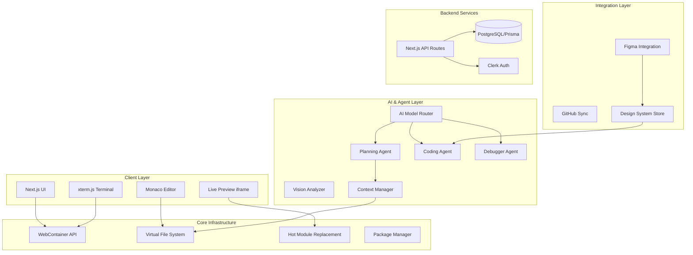

---

## 1. Core Infrastructure Layer

### 1.1 WebContainer API Integration

The WebContainer API (by StackBlitz) provides a browser-based Node.js runtime. This is the foundational technology that enables running a full development environment in the browser.

#### Architecture

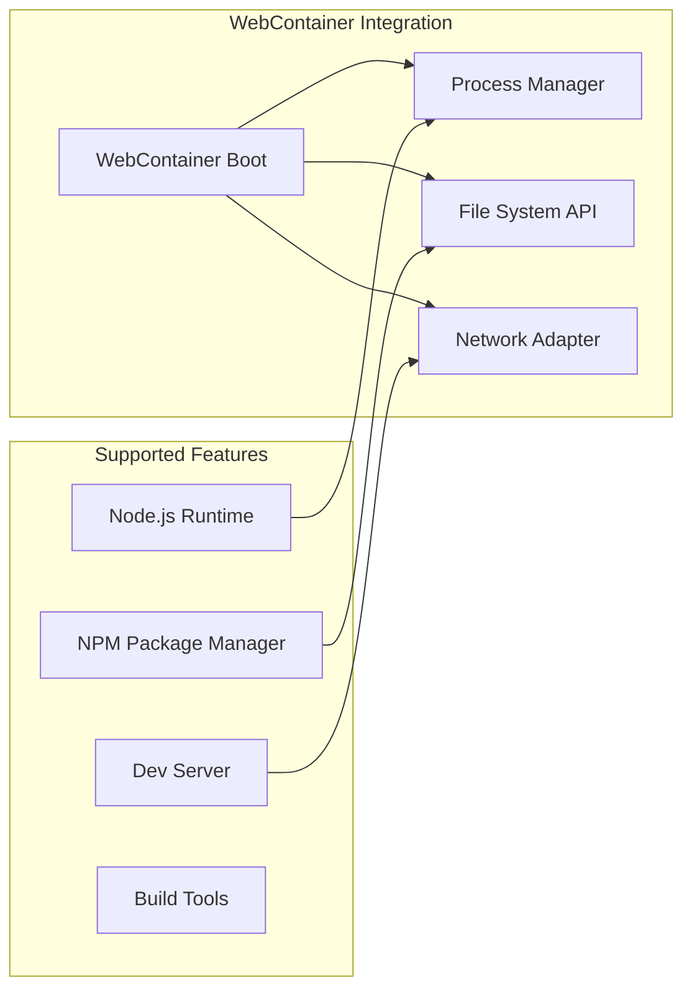

#### Implementation Requirements

| Component | Technology | Purpose |
|-----------|------------|---------|
| Runtime | `@webcontainer/api` | Browser-based Node.js |
| Bundler | Vite (in-browser) | Fast HMR and bundling |
| Package Manager | Custom npm implementation | Install packages without backend |
| Server | Express.js in WebContainer | Local dev server |

#### Key Interfaces

```typescript
interface WebContainerService {
  boot(): Promise<void>;
  mount(files: FileSystemTree): Promise<void>;
  spawn(command: string, args: string[]): Promise<Process>;
  on(event: 'server-ready', callback: (url: string) => void): void;
}

interface FileSystemTree {
  [key: string]: FileSystemFile | FileSystemDirectory;
}

interface FileSystemFile {
  file: { contents: string };
}

interface FileSystemDirectory {
  directory: FileSystemTree;
}
```

### 1.2 Virtual File System

The VFS maintains the project structure in memory and syncs with the WebContainer's file system.

#### Design

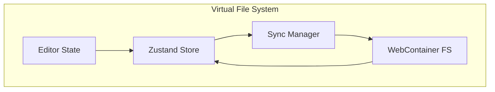

#### Core Operations

```typescript
interface VirtualFileSystem {
  // File operations
  readFile(path: string): Promise<string>;
  writeFile(path: string, content: string): Promise<void>;
  deleteFile(path: string): Promise<void>;
  createDirectory(path: string): Promise<void>;
  
  // Tree operations
  getFileTree(): Promise<FileNode>;
  watchDirectory(path: string, callback: WatchCallback): void;
  
  // Batch operations
  applyChanges(changes: FileChange[]): Promise<void>;
}
```

### 1.3 In-Browser Terminal

Implementation using xterm.js for terminal emulation within the browser.

#### Components

| Feature | Implementation |
|---------|---------------|
| Terminal Emulator | `xterm.js` + `xterm-addon-fit` |
| Input/Output | WebContainer process streams |
| Shell | Custom shell implementation |
| Themes | Match UI design system |

#### Code Reference
```typescript
interface TerminalService {
  attachToProcess(process: Process): void;
  write(data: string): void;
  resize(cols: number, rows: number): void;
  onData(callback: (data: string) => void): void;
}
```

### 1.4 Hot Module Replacement

Live preview updates without full page reloads.

#### Architecture

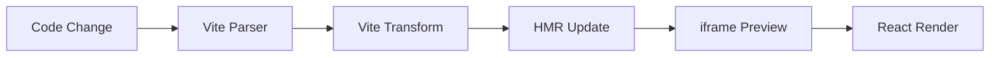

#### Implementation Strategy

1. **Vite HMR API**: Leverage Vite's built-in HMR for React components
2. **iframe Sandbox**: Run app in isolated iframe
3. **Connection**: WebSocket or postMessage for HMR updates
4. **Error Boundary**: Catch and display runtime errors

---

## 2. AI & Agentic Logic Layer

### 2.1 Multi-Agent Orchestration

The system uses specialized agents for different tasks, coordinated by an orchestrator.

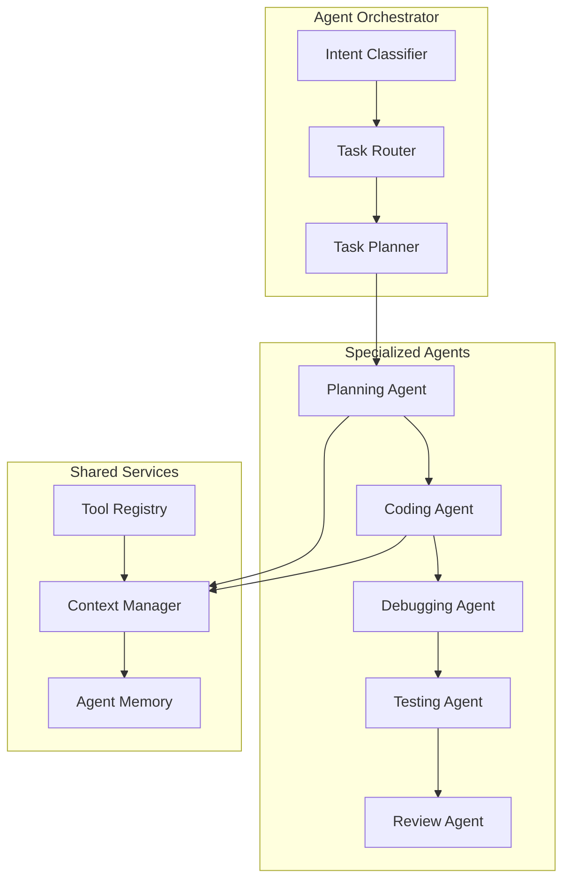

#### Agent Responsibilities

| Agent | Primary Task | Model |
|-------|--------------|-------|
| Planner | Break down requirements, create task list | Gemini 2.5 Pro |
| Coder | Generate/modify code files | Gemini 2.5 Pro |
| Debugger | Analyze errors, propose fixes | Gemini 2.5 Pro |
| Tester | Generate tests, verify functionality | Gemini 2.5 Flash |
| Review | Code quality, security review | Gemini 2.5 Pro |

### 2.2 Context Management

Efficiently feeding file tree and contents to the AI based on the current task.

```typescript
interface ContextManager {
  // Build context for AI requests
  buildContext(request: AIRequest): Promise<Context>;
  
  // Context includes:
  // - File tree (truncated paths)
  // - Open files content
  // - Relevant files (semantic search)
  // - Terminal output
  // - Error messages
}
```

#### Context Building Strategy

1. **File Tree**: First 3 levels, expandable on demand
2. **Open Files**: Full content + surrounding context
3. **Semantic Search**: Find relevant files using embeddings
4. **Window Context**: Last N lines of terminal + errors

### 2.3 Self-Correction System

An automatic debugging loop that handles runtime errors.

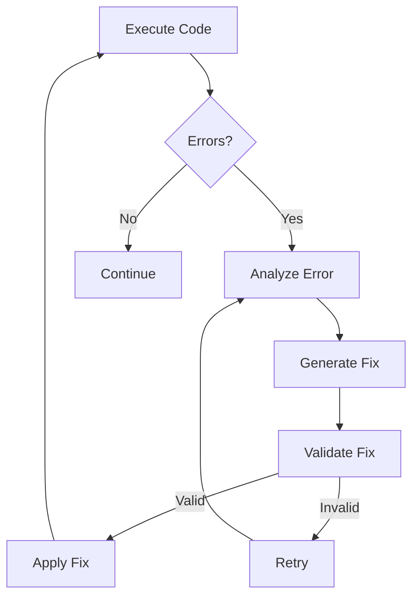

#### Implementation

```typescript
interface SelfCorrectionSystem {
  // Enable auto-correction loop
  enableAutoFix(): void;
  
  // Process errors from:
  // - TypeScript compiler
  // - Runtime errors
  // - Test failures
  
  // Max retries: 3
  // Exponential backoff between retries
  // Log all attempts for review
}
```

### 2.4 Prompt Enhancement Pipeline

Converting vague user prompts to detailed technical specifications.

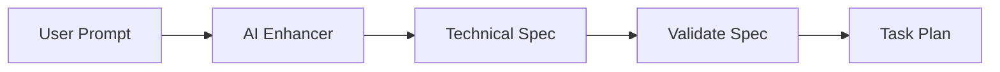

#### Enhancement Stages

1. **Clarification**: Ask clarifying questions if needed
2. **Expansion**: Convert to detailed technical requirements
3. **Tech Stack Selection**: Determine appropriate frameworks
4. **Component Breakdown**: Create component hierarchy

---

## 3. Developer Experience Layer

### 3.1 Monaco Editor Integration

Full-featured code editor with language support.

#### Configuration

```typescript
interface EditorConfig {
  theme: 'vs-dark' | 'custom';
  language: string;
  minimap: boolean;
  autoComplete: boolean;
  formatOnSave: boolean;
  extensions: string[];
}
```

#### Supported Languages

| Language | Support Level |
|----------|---------------|
| TypeScript | Full (IntelliSense, refactoring) |
| JavaScript | Full |
| JSON | Full |
| CSS/SCSS | Full |
| HTML | Full |
| Markdown | Basic |

### 3.2 Package Manager GUI

npm package search and installation UI.

#### Features

- Search npm registry
- View package details (version, downloads, deps)
- One-click installation
- Dependency resolution
- Version pinning

#### API Integration

```typescript
interface PackageManager {
  search(query: string, options?: SearchOptions): Promise<PackageResult[]>;
  install(packages: PackageSpec[]): Promise<void>;
  uninstall(packages: string[]): Promise<void>;
  getInstalled(): Promise<InstalledPackage[]>;
}
```

### 3.3 GitHub Synchronization

OAuth flow and repository operations.

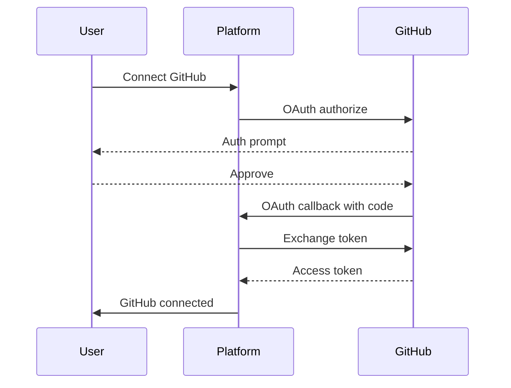

#### Operations Supported

| Operation | Implementation |
|-----------|---------------|
| Clone Repo | GitHub API + WebContainer git |
| Push | WebContainer git + GitHub API |
| Pull | WebContainer git + GitHub API |
| Branch | GitHub API |
| Create PR | GitHub API |

### 3.4 History & Snapshots

Version control and rewind functionality.

#### Features

- Automatic snapshots on significant changes
- Named snapshots (manual)
- Visual diff between snapshots
- One-click restore
- Export/import snapshots

---

## 4. Full-Stack & Deployment Layer

### 4.1 Managed Databases

SQLite in WebContainer with persistence strategy.

#### Architecture

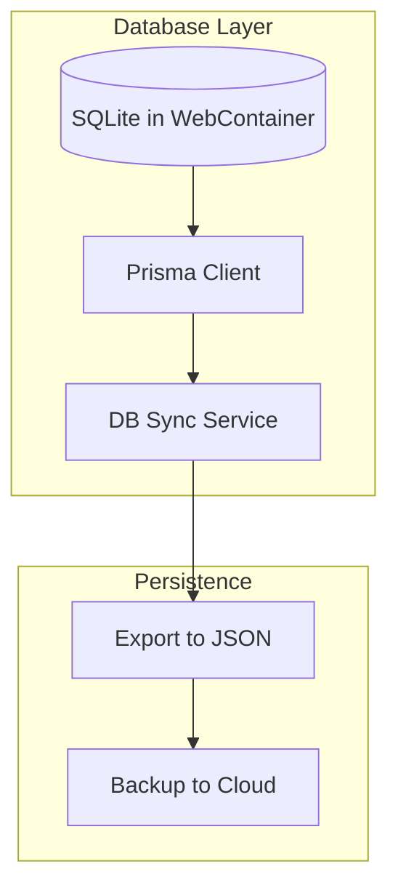

#### Implementation

- Use `better-sqlite3` in WebContainer
- Expose via custom Prisma engine
- Sync schema to PostgreSQL for production

### 4.2 Authentication Boilerplate

Pre-configured auth flows using Clerk (existing).

#### Integration Points

| Feature | Status |
|---------|--------|
| Clerk Auth | Already implemented |
| User Sessions | Extend for project access |
| API Keys | Add for AI services |
| Team Auth | Future phase |

### 4.3 One-Click Deployment

Integration architecture for Vercel/Netlify.

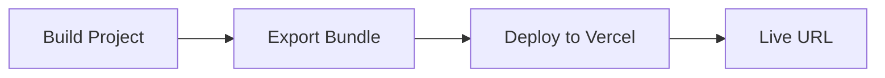

#### Implementation

1. **Build**: Run production build in WebContainer
2. **Package**: Create deployment artifact
3. **Deploy**: Use Vercel API / Netlify CLI
4. **Domain**: Auto-assign or custom domain

### 4.4 Environment Variable Management

Secure API key handling.

#### Strategy

```typescript
interface EnvManager {
  // User-provided keys (client-side)
  getUserKeys(): EnvVars;
  
  // Platform-provided keys (server-side proxy)
  getPlatformKeys(): Promise<ProxiedVars>;
  
  // Validate keys before use
  validateKeys(vars: EnvVars): Promise<ValidationResult>;
}
```

---

## 5. Integration with Existing Features

### 5.1 Figma Integration

How the new Bolt.new features integrate with existing Figma integration.

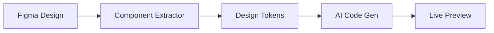

#### Workflow

1. **Import**: Fetch design from Figma API
2. **Extract**: Use existing `component-extractor.ts`
3. **Analyze**: Run through `vision-analyzer.ts` for tokens
4. **Generate**: Use AI to generate matching code
5. **Preview**: Render in WebContainer

### 5.2 Design System Generation

Leveraging existing design system store.

#### Integration Points

| Existing Component | Integration |
|-------------------|-------------|
| `useDesignSystemStore` | Theme generation |
| `VisionAnalyzer` | Token extraction |
| `ModelRouter` | Code generation |

### 5.3 Database Schema Extensions

Required Prisma schema additions.

```prisma
// ============ PROJECT MANAGEMENT ============

model Project {
  id                String    @id @default(cuid())
  name              String
  description       String?
  userId            String
  user              User      @relation(fields: [userId], references: [id])
  
  // WebContainer state
  files             String    // JSON: virtual file system
  dependencies      String    // JSON: package.json dependencies
  
  // Runtime state
  status            String    @default("stopped") // stopped, running, building
  previewUrl        String?
  webContainerId   String?
  
  // Snapshots
  snapshots         ProjectSnapshot[]
  
  createdAt         DateTime  @default(now())
  updatedAt         DateTime  @updatedAt
  
  @@index([userId])
}

model ProjectSnapshot {
  id          String   @id @default(cuid())
  projectId   String
  project     Project  @relation(fields: [projectId], references: [id])
  
  name        String
  description String?
  files       String   // JSON: complete file tree
  commitHash  String   @unique
  
  createdAt   DateTime @default(now())
  
  @@index([projectId])
}

// ============ AI AGENT STATE ============

model AgentSession {
  id              String   @id @default(cuid())
  projectId       String
  
  // Agent state
  currentAgent    String   // planner, coder, debugger, etc.
  taskList        String   // JSON: task breakdown
  completedTasks  String   // JSON: completed task IDs
  
  // Context
  contextWindow   String   // JSON: current context
  memory          String   // JSON: long-term memory
  
  // Status
  status          String   @default("idle") // idle, running, paused, completed
  errorCount      Int      @default(0)
  
  createdAt       DateTime @default(now())
  updatedAt       DateTime @updatedAt
  
  @@index([projectId])
}

model AgentExecution {
  id              String   @id @default(cuid())
  sessionId       String
  
  // Execution details
  agentType       String
  task            String
  input           String   // JSON: task input
  output          String   // JSON: task output
  
  // Timing
  startedAt       DateTime
  completedAt    DateTime?
  durationMs     Int?
  
  // Result
  success         Boolean
  error          String?
  
  @@index([sessionId])
}

// ============ GITHUB INTEGRATION ============

model GitHubConnection {
  id              String   @id @default(cuid())
  userId          String   @unique
  
  accessToken     String   // Encrypted
  refreshToken    String?
  tokenExpiresAt  DateTime?
  
  githubId        String?
  githubUsername  String?
  
  createdAt       DateTime @default(now())
  updatedAt       DateTime @updatedAt
}

model GitHubRepo {
  id              String   @id @default(cuid())
  userId          String
  
  owner           String
  name            String
  fullName        String   @unique
  
  defaultBranch   String   @default("main")
  lastSyncedAt    DateTime?
  
  // Project linkage
  projectId       String?  @unique
  project         Project? @relation(fields: [projectId], references: [id])
  
  createdAt       DateTime @default(now())
  updatedAt       DateTime @updatedAt
  
  @@index([userId])
}

// ============ DEPLOYMENT ============

model Deployment {
  id              String   @id @default(cuid())
  projectId       String
  project         Project  @relation(fields: [projectId], references: [id])
  
  // Deployment info
  provider        String   // vercel, netlify, etc.
  url             String?
  deployId        String?
  
  // Build info
  buildStatus     String   @default("pending")
  buildOutput     String?
  startedAt       DateTime
  completedAt     DateTime?
  
  // Errors
  error           String?
  
  createdAt       DateTime @default(now())
  
  @@index([projectId])
}
```

---

## 6. API Endpoint Specifications

### 6.1 Project Management

| Endpoint | Method | Description |
|----------|--------|-------------|
| `/api/projects` | GET | List user projects |
| `/api/projects` | POST | Create new project |
| `/api/projects/:id` | GET | Get project details |
| `/api/projects/:id` | PATCH | Update project |
| `/api/projects/:id` | DELETE | Delete project |

### 6.2 File Operations

| Endpoint | Method | Description |
|----------|--------|-------------|
| `/api/projects/:id/files` | GET | List files in project |
| `/api/projects/:id/files` | POST | Create/update file |
| `/api/projects/:id/files/:path` | DELETE | Delete file |

### 6.3 AI Agent

| Endpoint | Method | Description |
|----------|--------|-------------|
| `/api/agent/execute` | POST | Execute agent task |
| `/api/agent/stream` | GET | SSE for agent progress |
| `/api/agent/cancel` | POST | Cancel running agent |

### 6.4 Package Manager

| Endpoint | Method | Description |
|----------|--------|-------------|
| `/api/packages/search` | GET | Search npm registry |
| `/api/projects/:id/packages` | GET | List installed packages |
| `/api/projects/:id/packages` | POST | Install packages |
| `/api/projects/:id/packages/:name` | DELETE | Uninstall package |

### 6.5 Deployment

| Endpoint | Method | Description |
|----------|--------|-------------|
| `/api/projects/:id/deploy` | POST | Deploy project |
| `/api/projects/:id/deployments` | GET | List deployments |
| `/api/deployments/:id/logs` | GET | Get deployment logs |

---

## 7. Technology Stack

### 7.1 Core Technologies

| Layer | Technology | Version |
|-------|------------|---------|
| Framework | Next.js | 14+ |
| Language | TypeScript | 5.x |
| Styling | Tailwind CSS | 3.x |
| UI Components | shadcn/ui | Latest |
| Auth | Clerk | Latest |

### 7.2 Infrastructure

| Component | Technology | Purpose |
|-----------|------------|---------|
| Browser Runtime | @webcontainer/api | Node.js in browser |
| Editor | Monaco Editor | Code editing |
| Terminal | xterm.js | Terminal emulation |
| Bundler | Vite | Fast HMR |

### 7.3 AI Integration

| Component | Technology |
|-----------|------------|
| Model Router | Gemini 2.5 (existing) |
| Vision | Gemini 2.5 Pro Vision (existing) |
| Code Gen | Gemini 2.5 Pro |

### 7.4 Integrations

| Service | Technology |
|---------|------------|
| Design | Figma API |
| GitHub | GitHub API + Octokit |
| Deployment | Vercel API / Netlify API |
| Database | PostgreSQL + Prisma |

---

## 8. Implementation Phases

### Phase 1: Core Infrastructure (Weeks 1-2)

| Priority | Task | Description |
|----------|------|-------------|
| P0 | WebContainer Boot | Initialize WebContainer API |
| P0 | Virtual FS | Basic file CRUD operations |
| P0 | File Tree UI | Display project structure |
| P1 | Terminal | xterm.js integration |
| P1 | Live Preview | iframe with HMR |

### Phase 2: AI Integration (Weeks 3-4)

| Priority | Task | Description |
|----------|------|-------------|
| P0 | Agent Framework | Multi-agent orchestration |
| P0 | Context Manager | Build context for AI |
| P1 | Code Generation | Basic code generation |
| P1 | Self-Correction | Error handling loop |
| P2 | Prompt Enhancement | Vague prompt → spec |

### Phase 3: Developer Experience (Weeks 5-6)

| Priority | Task | Description |
|----------|------|-------------|
| P0 | Monaco Editor | Full editor integration |
| P0 | Package Manager | npm search/install UI |
| P1 | GitHub Sync | OAuth + repo operations |
| P1 | Snapshots | Version control UI |
| P2 | History | Action history |

### Phase 4: Full-Stack & Deployment (Weeks 7-8)

| Priority | Task | Description |
|----------|------|-------------|
| P1 | Database in Browser | SQLite in WebContainer |
| P1 | Auth Extension | Project-level permissions |
| P0 | One-Click Deploy | Vercel/Netlify integration |
| P2 | Environment Vars | Secure key management |

### Phase 5: Integration & Polish (Weeks 9-10)

| Priority | Task | Description |
|----------|------|-------------|
| P1 | Figma Import | Import from Figma designs |
| P2 | Design System | Generate from tokens |
| P1 | Performance | Optimize cold starts |
| P0 | Error Handling | Robust error recovery |

---

## 9. Key Architectural Decisions

### 9.1 Why WebContainer?

- **No backend required**: All Node.js operations in browser
- **Security**: Isolated sandbox environment
- **Performance**: Instant feedback loop
- **Cost**: No server costs for runtime

### 9.2 Why Multi-Agent?

- **Specialization**: Each agent optimized for specific task
- **Reliability**: Isolated failures don't cascade
- **Scalability**: Agents can run in parallel
- **Debugging**: Easier to trace issues

### 9.3 Context Strategy

- **Hybrid**: Combine file tree + semantic search
- **Efficient**: Only send relevant context
- **Token-aware**: Respect model context limits
- **Caching**: Reuse context when possible

### 9.4 Persistence Strategy

- **Hybrid**: SQLite for dev, PostgreSQL for prod
- **Export**: JSON backup for portability
- **Sync**: Optional cloud persistence

---

## 10. Security Considerations

### 10.1 WebContainer Sandbox

- No direct file system access outside WebContainer
- Network requests proxied through WebContainer
- No access to browser localStorage from WebContainer

### 10.2 API Key Management

- User keys never stored in plain text
- Platform keys proxied through backend
- Keys validated before use

### 10.3 Deployment Security

- Deployments run in isolated cloud environments
- No secrets exposed in build logs
- HTTPS enforced on all deployments

---

## 11. Performance Targets

| Metric | Target |
|--------|--------|
| WebContainer boot | < 3 seconds |
| File operations | < 100ms |
| AI response (code gen) | < 10 seconds |
| Live preview update | < 500ms |
| Deployment start | < 30 seconds |

---

## 12. Migration Path for Existing Features

### 12.1 AI Agent Integration

The existing `src/app/agent/page.tsx` will be enhanced to:
1. Use the new WebContainer for code execution
2. Integrate with multi-agent system
3. Provide live preview capabilities

### 12.2 Design System Store

The existing `useDesignSystemStore.ts` will:
1. Generate code from design tokens
2. Inject into WebContainer file system
3. Preview in live environment

### 12.3 Figma Integration

The existing Figma integration will:
1. Import designs → extract tokens
2. Generate matching components
3. Open in new project in WebContainer

---

## Conclusion

This architecture provides a comprehensive blueprint for building a Bolt.new-like platform. The modular design allows for incremental implementation while maintaining integration between components. The focus on browser-based infrastructure reduces costs and improves user experience through instant feedback loops.

Key success factors:
1. **Start with core infrastructure** (WebContainer, VFS)
2. **Build AI layer incrementally** (agent framework → code gen → debugging)
3. **Prioritize developer experience** (editor, terminal, preview)
4. **Integrate existing features** (Figma, design system, auth)

This plan is a living document and should be updated as the implementation progresses and new requirements emerge.
